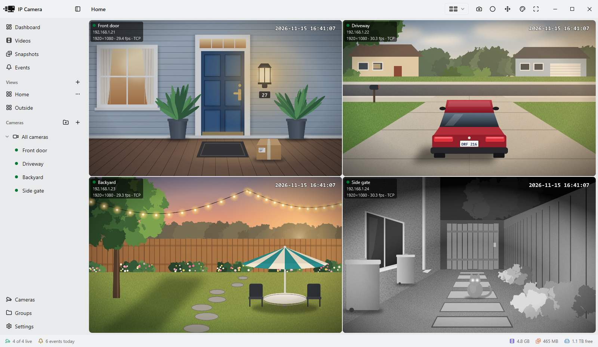
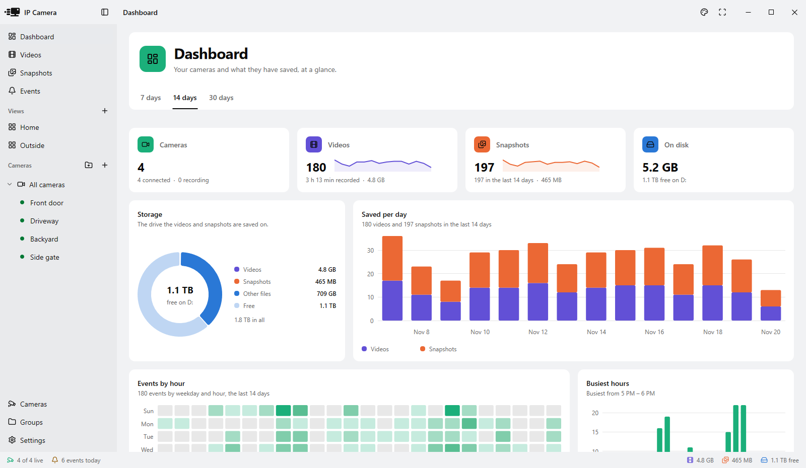
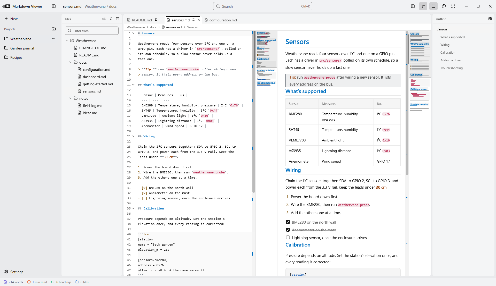

<p>
  <picture>
    <source media="(prefers-color-scheme: dark)" srcset="assets/brand/drifting-prompts/logo/drifting-prompts-horizontal-inverse.svg">
    
  </picture>
</p>

Small desktop apps, built in Rust: a viewer for your IP cameras and a reader for folders of Markdown. They share the
same controls, themes and Settings, and keep their data in a folder beside the app, with no account or cloud service.
The screens are TSX on [nsh](https://github.com/longbridge/nsh), a native UI framework.

## The apps

###  IP Camera

A viewer for the IP cameras on your network. It decodes H.264 and H.265 in Rust, so there are no codecs to install.

<picture>
  <source media="(prefers-color-scheme: dark)" srcset="assets/screenshots/ipcamera-dark.png">
  
</picture>

- Live video with sound from several cameras, in tile layouts you save
- Pan, tilt and zoom
- Snapshots and recordings, including recording on motion or AI detections, starting a few seconds early
- A log of what the cameras saw
- RTSP for video; Reolink's, Dahua's and Amcrest's APIs and ONVIF for PTZ, detections and lights; a search for cameras
  on your network
- Camera passwords saved encrypted for your user account
- A server that runs the app in a browser, without the desktop app

<picture>
  <source media="(prefers-color-scheme: dark)" srcset="assets/screenshots/ipcamera-dashboard-dark.png">
  
</picture>

More in [IP Camera's README](crates/ipcamera/README.md).

###  Markdown Viewer

A reader for folders of Markdown: notes, documentation, a repository's READMEs.

<picture>
  <source media="(prefers-color-scheme: dark)" srcset="assets/screenshots/mdviewer-dark.png">
  
</picture>

- Folders open as projects, their files in a tree, by folder or in one list
- Files in tabs: a preview tab, pinned tabs, dragged into order
- Each file raw (highlighted), rendered, or both side by side, with its outline and a map of the whole file
- Search across a project, with the results in a tab of their own

More in [Markdown Viewer's README](crates/mdviewer/README.md).

## Status

Both apps are early, and Markdown Viewer reads files but doesn't edit them. There are no packaged downloads yet, so
build from source.

## Setup

These steps are for Windows and Linux. You need Rust 1.97 or newer and nsh 0.6.1; cargo builds the video stack itself.

### Windows

1. Install Rust with [rustup](https://rustup.rs).
2. Install nsh. It installs to `%LOCALAPPDATA%\nsh` and adds itself to `PATH`, so open a new terminal afterward:

   ```powershell
   $env:NSH_VERSION = 'v0.6.1'
   irm https://nsh.dev/install.ps1 | iex
   ```

3. Clone this repository and, from its folder, run `cargo ipcamera` or `cargo mdviewer`. The first build takes a few
   minutes; later ones take seconds.

Build from PowerShell, not Git Bash ([Troubleshooting](#troubleshooting)).

### Linux

Ubuntu 24.04 or later, or another distribution with GTK 4.14 or newer.

1. Install Rust with [rustup](https://rustup.rs):

   ```sh
   curl --proto '=https' --tlsv1.2 -sSf https://sh.rustup.rs | sh
   ```

2. Install what nsh builds against (GTK 4, WebKitGTK, GStreamer), a C compiler, clang and LLVM. On Ubuntu or Debian:

   ```sh
   sudo apt install build-essential pkg-config clang llvm libgtk-4-dev libwebkitgtk-6.0-dev libgstreamer1.0-dev libgstreamer-plugins-base1.0-dev
   ```

   On Fedora:

   ```sh
   sudo dnf install gcc pkgconf-pkg-config clang llvm gtk4-devel webkitgtk6.0-devel gstreamer1-devel gstreamer1-plugins-base-devel
   ```

3. Install nsh. It installs to `~/.nsh` and links itself into `~/.local/bin`; if that isn't on your `PATH`, the
   installer says how to add it:

   ```sh
   curl -fsSL https://nsh.dev/install.sh | NSH_VERSION=v0.6.1 sh
   ```

4. Clone this repository and, from its folder, run `cargo ipcamera` or `cargo mdviewer`.

### Optional: the web build

IP Camera's web build needs the WebAssembly target and clang, once per machine
([why](crates/ipcamera/README.md#the-web-build)). On Windows, from `crates/ipcamera/app`:

```powershell
rustup target add wasm32-unknown-unknown
powershell -ExecutionPolicy Bypass -File tools\fetch-wasm-clang.ps1
```

The script downloads clang (about 266 MiB) into `tools\llvm` and points cargo at it in `.cargo\config.toml`. Git
ignores both; delete them to undo it. On Linux, clang came with the packages above, so only
`rustup target add wasm32-unknown-unknown` is left.

## Common commands

From the repository root:

```powershell
cargo ipcamera                # run IP Camera, with hot reload
cargo mdviewer                # run Markdown Viewer
cargo ipcamera-web            # run IP Camera's server and web build together, at http://localhost:8787/

cargo test --workspace        # test everything except the apps
cargo clippy --workspace --all-targets -- -D warnings
cargo fmt --all

cargo package-ipcamera        # package IP Camera into crates\ipcamera\app\.nsh\out\
cargo package-mdviewer        # package Markdown Viewer into crates\mdviewer\app\.nsh\out\
```

Only one app runs under nsh at a time: starting one stops the other. Each app's own tests run with `nsh test` from its
folder.

## Troubleshooting

- **Link errors from a Git Bash build**: Git ships its own `link.exe`, which can shadow Microsoft's linker. Build from
  PowerShell.
- **MSVC's `D8050 ... failed to get command line into debug records`, or gcc's "Cannot create temporary file"**: a Low
  integrity label on the repository folder, not long paths. Check with `icacls . | Select-String 'Mandatory Label'`.
- **nsh stops at once in an app's folder**: each app's `nsh.json` requires nsh 0.6.1 exactly; check `nsh --version` and
  reinstall with `NSH_VERSION` set as above.
- **`failed to find tool` naming `clang` or `llvm-ar`** in the web build: its setup above hasn't been done on this
  machine.

## Repository layout

Each product has a folder under `crates/`, and what more than one product uses is in `crates/dp/`. The two apps and
`dp-ui` are built with nsh, each a Cargo workspace of its own; `cargo` at the root builds the rest.

| Package | Folder | What it does |
| --- | --- | --- |
| `ipcamera-core` | `crates/ipcamera/core` | Cameras, groups, views and settings, and talking to cameras |
| `ipcamera-dpapi` | `crates/ipcamera/dpapi` | Encrypts the cameras' passwords for your user account |
| `ipcamera-media` | `crates/ipcamera/media` | The video pipeline: RTSP, decoding, sound and recording |
| `ipcamera-storage` | `crates/ipcamera/storage` | Snapshots and recordings on disk |
| `ipcamera-server` | `crates/ipcamera/server` | The cameras and the app in a browser ([README](crates/ipcamera/server/README.md)) |
| `ipcamera` | `crates/ipcamera/app` | The IP Camera app, crate `nsh-app-ipcamera` ([README](crates/ipcamera/app/README.md)) |
| `mdviewer-core` | `crates/mdviewer/core` | Projects, their files, and a file's outline |
| `mdviewer` | `crates/mdviewer/app` | The Markdown Viewer app, crate `nsh-app-mdviewer` |
| `dp-store` | `crates/dp/store` | Settings files that save safely |
| `dp-ui` | `crates/dp/ui` | The shared controls, themes and window helpers |
| `xtask` | `crates/xtask` | The repository's cargo commands |

## Where to read more

- [`crates/README.md`](crates/README.md): the workspaces, checks and CI, releases, the shared crates, themes, and nsh
  workarounds
- [`crates/ipcamera/README.md`](crates/ipcamera/README.md): IP Camera as a whole: its crates, what it saves, releases
  and camera checks
- [`crates/ipcamera/app/README.md`](crates/ipcamera/app/README.md): everything you see in the IP Camera app
- [`crates/ipcamera/server/README.md`](crates/ipcamera/server/README.md): the server and its API
- [`crates/mdviewer/README.md`](crates/mdviewer/README.md): Markdown Viewer
- [`AGENTS.md`](AGENTS.md): guidance for AI coding agents working in this repository

## License

MIT. See [LICENSE](LICENSE).
