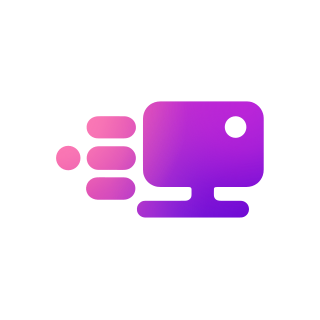

# The crates

Each product has a folder here. What more than one product uses lives in `dp/` as `dp-*` crates, moved there once a
second product needs it. A package name carries its product (`ipcamera-core` in `crates/ipcamera/core`), since Cargo
needs every name in a workspace to differ and `core` is Rust's own.

| Folder | What it is |
| --- | --- |
| `ipcamera/` | IP Camera: `core`, `dpapi`, `media`, `storage`, `server` and `app` ([README](ipcamera/README.md)) |
| `mdviewer/` | Markdown Viewer: `core` and `app` ([README](mdviewer/README.md)) |
| `dp/store` | `dp-store`: settings files saved safely, and the lock helper ([below](#dp-store)) |
| `dp/ui` | `dp-ui`: the styled TSX controls, the themes, and the Rust under them ([below](#dp-ui)) |
| `xtask/` | The repository's own commands, run through cargo ([below](#the-repositorys-commands)) |

## The workspaces

nsh needs the two apps and `dp-ui` to be Cargo workspaces of their own, so `cargo` at the root never builds them.

| Workspace | Crates | Built and tested by |
| --- | --- | --- |
| The root (`Cargo.toml`) | `dp-store`, `ipcamera-core`, `ipcamera-dpapi`, `ipcamera-media`, `ipcamera-storage`, `ipcamera-server`, `mdviewer-core`, `xtask` | `cargo` at the root |
| `crates/ipcamera/app` | IP Camera's app | `nsh` in its folder, and `cargo` there for its Rust |
| `crates/mdviewer/app` | Markdown Viewer's app | `nsh` in its folder, and `cargo` there for its Rust |
| `crates/dp/ui` | `dp-ui` | `cargo` in its folder; either app's `nsh check` type checks its TSX |

An app builds through a workspace nsh generates in its `.nsh/rust`, which pulls in `dp-ui`. Cargo reads profiles only
from the workspace it builds, so a profile meant for the apps goes in `.cargo/config.toml`, not a `Cargo.toml`.

### The repository's commands

`crates/xtask` holds them, as cargo aliases in `.cargo/config.toml`. It depends on none of the other crates.

| Command | What it does |
| --- | --- |
| `cargo ipcamera`, `cargo mdviewer` | `nsh run` in the app's folder, passing on any arguments |
| `cargo package-ipcamera`, `cargo package-mdviewer` | `nsh package --target windows` in the app's folder |
| `cargo package-ipcamera-web` | `nsh package --target web` in IP Camera's folder |
| `cargo ipcamera-web` | `ipcamera-server` and the web build together ([the server's README](ipcamera/server/README.md)) |
| `cargo screenshots` | The READMEs' screenshots ([Screenshots](#screenshots)) |

### The Rust floor

The root workspace needs Rust 1.95, the highest `rust-version` among its dependencies (from glass2glass's `loom`),
recorded as `rust-version` in the root `Cargo.toml`; CI checks it with exactly that version. The nsh workspaces need
1.97, nsh 0.6.1's. Keep the `nsh-*` dependencies at the installed `nsh`'s version (`nsh --version`), and raise them
together.

### `.cargo/config.toml`

The root one, which `nsh run` also reads:

- optimizes `rust_h264`, `rust_h265` and `g2g-plugins` in the dev profile, since unoptimized a 1080p H.265 camera falls
  behind;
- links with `rust-lld.exe`, which every toolchain ships;
- gives full debug info only to the suite's own crates, and line tables to the rest, which keeps the PDBs a quarter to
  half the size. A new crate of ours gets a line there.

## Checks and CI

The root workspace's gates, from the repository root:

```powershell
cargo fmt --all --check
cargo clippy --workspace --all-targets -- -D warnings
cargo test --workspace
```

`cargo test -p ipcamera-core -p mdviewer-core -p dp-store` is the fast subset (no media stack, no display). The nsh
workspaces' gates:

| From | Run |
| --- | --- |
| `crates/ipcamera/app`, `crates/mdviewer/app` | `nsh test`, `cargo clippy --all-targets -- -D warnings`, `cargo fmt --check` |
| `crates/dp/ui` | `cargo test`, `cargo clippy --all-targets -- -D warnings`, `cargo fmt --check`, and either app's `nsh check` for its TSX |

The workflows are in `.github/workflows-todo/` ([`ci.yml`](../.github/workflows-todo/ci.yml),
[`release.yml`](../.github/workflows-todo/release.yml)); GitHub runs only what is in `.github/workflows/`. Each runs
only by hand: in the Actions tab, pick it, press "Run workflow" and choose a branch or tag under "Use workflow from".

CI's jobs: formatting; `ipcamera-core`, `mdviewer-core` and `dp-store` on Linux with no system libraries, which keeps
them free of the media stack; clippy and tests of the root workspace on Linux; `cargo check` on Rust 1.95; clippy of
the root workspace on Windows, without tests; and `cargo fmt --check`, clippy and `cargo test` for each app and `dp-ui`
on Windows. `nsh check` and `nsh test` need `nsh`, so CI doesn't run them.

## Releases

`release.yml` packages the apps. Each product has its own version (`version` in its app's `nsh.json`) and its own tags,
`ipcamera-v<version>` and `mdviewer-v<version>`.

- **A tag** packages that app and publishes it to the tag's release as `<product>-windows-x86_64-v<version>.zip`. The
  run stops in seconds if the tag names no product or its version disagrees with the app's `nsh.json`.
- **A branch** packages both apps as downloads on the run's page
  (`<product>-windows-x86_64-v<version>-<branch>-<commit>.zip`) and publishes nothing.

A run uses `release.yml` as it was at the tag or branch picked. It installs the `nsh` matching `nsh-core` in the app's
`Cargo.toml`, and creates the release only once the package is built, so a failed build leaves no release.

An archive holds the app's executable, the `nsh` runtime folder beside it, `LICENSE.txt` (MIT) and
`THIRD-PARTY-NOTICES.txt` (the license of every crate compiled in, with where to find its source). Nothing is signed,
so the system warns that the binary is unsigned.

The notices come from [cargo-about](https://github.com/EmbarkStudios/cargo-about), run on nsh's generated
`.nsh/rust/windows-app`, with its settings and template in `.github/notices/`. `accepted` in `about.toml` lists the
licenses a release may ship; a crate under any other stops the release, so check a new dependency's license first. To
see the notices locally, package the app (`cargo package-ipcamera`), then from the root:

```powershell
cargo install cargo-about --version 0.9.3 --locked --features cli
cargo about generate --config .github/notices/about.toml --manifest-path crates/ipcamera/app/.nsh/rust/windows-app/Cargo.toml --output-file "$env:TEMP\notices.txt" .github/notices/notices.hbs
```

## dp-store

`crates/dp/store`, plain Rust in the root workspace. `src/lib.rs` loads and saves the JSON files (each app's
`settings.json`, Markdown Viewer's `projects.json`, IP Camera's `data\settings`): atomically, never over a file it
couldn't read, owner-only on Unix for a document marked `OWNER_ONLY` (`cameras.json`), and in memory for the web
preview. `src/sync.rs` takes a lock even after a panic in another thread; it's also `ipcamera_core::sync`.

## dp-ui

`crates/dp/ui` makes the products look and behave alike. It's built with nsh, a workspace of its own. Each app imports
its TSX by path (`../../dp/ui` from `App.tsx`, `../../../dp/ui` from `views/`), names its theme file in `nsh.json`, and
registers its `Themes` module before it shows anything (`connectThemes`). `nsh/base` brings behavior and accessibility;
`dp-ui` brings the look.

- **Entry and look**: `index.ts` (every export), `brand.tsx` (the themes and `look()`), `theme.json` and `themes/`
  (the colors), `elevation.ts`, `texture.ts`, `appearance.tsx` (the Appearance settings, the title bar's theme menu,
  the saved appearance).
- **The window's frame**: `titlebar.tsx`, `nav.tsx` (the sidebar), `panel.tsx`, `island.tsx`, `edge.tsx`,
  `scrollbar.ts`, `collapsing.tsx` and `tabs.tsx` (a page's tabs and a reader's file tabs), `breadcrumbs.tsx`,
  `menu.tsx`, `window.ts` (the window's place and full screen).
- **Dialogs and Settings**: `editor.tsx` (the dialog editors open in), `dialog.tsx`, `settings.tsx` (every product's
  Settings and its Appearance section), `rows.tsx`, `segmented.tsx`, `appear.tsx`.
- **Controls**: `button.tsx`, `field.tsx`, `press.tsx`, `card.tsx`, `chart.tsx`, `table.tsx`, `search.tsx`,
  `tree.tsx`, `count.tsx`, `reorder.tsx` (dragging into order), `pad.tsx`, `media.tsx`, `empty.tsx`, `status.tsx`,
  `toast.tsx`, `note.tsx`, `spinner.tsx`, `icon.tsx`, `lucide.ts`, `logo.tsx`, `logos.ts` (the products' marks, in the
  code so each ships in its bundle).
- **Its Rust**: `src/lib.rs` (the `Themes` module, `SavedAppearance` and `WindowPlace`), `src/listen.rs` (`listen` and
  `listen_later`, for the bridges' listeners), `src/folders.rs` (picking, opening and showing folders through nsh's own
  calls).

## Themes

The themes, textures and elevation are the same in every product: each app's Settings shows them in its Appearance
section, and the title bar's theme menu picks the mode and theme too. Every theme is light or dark; the app keeps a pick
for each appearance in `settings.json` and shows the one for the current appearance. A name it doesn't know falls back
to that appearance's Default.

A theme is three layers:

- **The colors** are tokens: Default's in `crates/dp/ui/theme.json`, with a theme file's laid over them. Classes name
  them (`bg-title-bar`, `ring-ring`), and `Themes.colors` reads them where a class can't.
- **The look** is a `Look` per theme in `crates/dp/ui/brand.tsx`: the classes and styles for every themed place, with
  the elevation on top (`raise`).
- **The theme shown** is the pick for the current appearance, which `look()` returns the look of.

A component asks `look()` how to draw and never checks the theme itself, so a new theme reaches every place at once. A
place that needs something new gets a field on `Look`. The shared controls apply the look, so a page built from them
is themed with no extra work.

Default is nsh's flat look and tokens with the suite's own page, frame, card and chart colors. In every theme, red
means recording, and the logo is the mark in black on light or white on dark. The system draws the window's buttons,
its dialogs and the right-click menus, which follow light and dark but not the theme; in a browser the app draws its
menus in the theme's colors.

### Theme files

Every other theme is a file in `crates/dp/ui/themes/` in `theme.json`'s format (shadcn's `cssVars`, which nsh reads),
colors only, with a value for every token: nsh's own (`background`, `primary`, `sidebar`, ...) and the ones
`theme.json` adds (`title-bar`, `status-bar`, `toolbar-hover`, `option`, `nav-selection`, `menu-selection`, `field`,
`dropdown`, `state-outline`, ...). Markdown Viewer's colors are tokens too: `syntax-heading`, `syntax-link`,
`syntax-code`, `syntax-marker`, `syntax-punctuation`, `syntax-strong`, `syntax-emphasis` and `syntax-quote`. A fenced
code block keeps nsh's own colors in every theme.

nsh reads one theme file at build time, so `Themes.apply` lays the picked file over `theme.json` while the app runs;
`Themes.apply(null)` restores the app's own.

`dp-ui`'s `cargo test` fails on a theme file that doesn't parse, lacks a token or isn't in `THEME_FILES`.
`crates/ipcamera/app/Brand.test.ts` checks the shared controls' and Markdown's colors against their surfaces in every
theme: 4.5:1 for text, 3:1 for field outlines and focus rings.

To add a theme:

1. Write its file in `crates/dp/ui/themes/`, with every token.
2. Add it to `THEME_FILES` in `crates/dp/ui/src/lib.rs`.
3. Add it to `THEMES` in `crates/dp/ui/brand.tsx`, in its appearance's section.
4. Run `cargo test` in `crates/dp/ui` and `nsh test Brand.test.ts` in `crates/ipcamera/app`.

Every product then has it.

## Islands

A window with panes side by side (Markdown Viewer's files, file and outline; IP Camera's video and PTZ panel) sets each
pane on the window's frame as an island (`Island` inside `Islands`, in `crates/dp/ui/island.tsx`), resized by dragging
the gap between two (`GRIP_HANDLE`). Islands stand apart in three tiers worked out from each theme's own colors
(`Look.tiers`): the frame, which the sidebar shares; a tool pane's island (the files, the outline, the PTZ panel); and
the document's island (the file, the video). Pages and dialogs aren't islands.

## Textures

A texture is a finish over the page headers' banners, in any theme (`crates/dp/ui/texture.ts`): **None** (the default),
**Haze** or **Dots**. Both draw natively, not with an nsh `Shader`, whose GPU device alone costs about 145 MB.
`settings.json` keeps the name; one it doesn't know shows None.

## Elevation

The elevation adds depth over every theme (`crates/dp/ui/elevation.ts`, `raise` in `brand.tsx`): **None**, the default
and flat; **Soft**, shadows under raised things; or **Raised**, which adds light to their edges and presses in what
takes input. The high contrast themes stay flat at every level. `settings.json` keeps the name; one it doesn't know is
None.

Every card is `Card` in `crates/dp/ui/card.tsx`, which puts the shadow on the rounded view. A clipping parent cuts off
a child's shadow, so a card inside one needs `SHADOW_ROOM` around it.

## Workarounds for nsh 0.6.1

nsh's website and gallery follow its `main` branch, past 0.6.1: check what you take from them against the installed
crates. Each workaround goes once a release covers it:

- **Stopping PTZ as the window closes**: in `VideoView`'s `Drop` (`crates/ipcamera/app/src/video.rs`), since nsh sends
  the close event to JS, which a closing window never waits for.
- **Menus in a browser**: drawn (`MenuOpener`, `popupMenu` and `MenuLayer` in `crates/dp/ui/menu.tsx`), since
  `Menu.popup` does nothing there. A button's menu opens under the button, not at the pointer, and a dialog covering
  the window places a `MenuLayer` last.
- **Picking several items in a tree**: `TreeList` in `crates/dp/ui/tree.tsx` lets its rows handle their own presses
  (`marked`, `onPress`), since `Tree` selects one item and its presses don't say which keys were held. Shift with an
  arrow doesn't pick a range.
- **Escape from a text field in a dialog**: `EditorDialog` in `crates/dp/ui/editor.tsx` binds Escape, since `Dialog`
  closes on Escape only while no text field has the keyboard.
- **Split's scrolling and the map's band**: Markdown Viewer polls its raw editor's scroll offset (`RAW_CHECK_EVERY` in
  `views/scrollsync.ts`) and visible lines (`MAP_VIEW_CHECK_ACTIVE`, `MAP_VIEW_CHECK_IDLE` in `views/reader.tsx`),
  since `Editor` has no `onScroll`.
- **Markdown Viewer's rendered page**, in a web view: one with the keyboard focus keeps every key from the window's
  keymap, F11 included, so the page sends the app's shortcuts back (`page/page.js`, `views/shortcuts.ts`) and stops
  the browser's own; it stops the browser's context menu and asks for the app's (`views/page.tsx`); and it asks for
  each of the project's pictures as a `data:` URL (`Documents.picture`), since nsh doesn't serve a web view's
  `url_scheme` there.
- **Settings saved by the development host**: each app's development host saves in a `.nsh` folder beside it
  (`development_folder` in `crates/dp/ui/src/lib.rs`), since `nsh run` rebuilds the app on a change to any `.json` file
  in its folder, `target` included, and skips only folders named `.nsh`.

## Brands

`assets/brand/` has a folder per brand, with its logos and a `brand.json` (its name, tagline and palette).

| | Brand | Folder |
| --- | --- | --- |
|  | Drifting Prompts, the suite | `assets/brand/drifting-prompts` |
|  | IP Camera | `assets/brand/ipcamera` |
|  | Markdown Viewer ("MD Viewer" in its logo and `brand.json`) | `assets/brand/mdviewer` |

Each `logo/` folder has the same set, as SVG (letters as outlines) and 2048-pixel PNG: `*-color`,
`*-horizontal-color`, `*-stacked-color`, `*-wordmark-color`, `*-icon-color` (the mark alone), `*-inverse`,
`*-horizontal-inverse`, `*-mono` and `*-reversed`.

The products ship their own copies: each app's `icon.png` is rendered from `ipcamera/ip-camera-app-icon.svg` or
`mdviewer/md-viewer-app-icon.svg`, the logo an app draws is its `*-icon-color` mark in `crates/dp/ui/logos.ts`, and the
READMEs' headers use `*-horizontal-color`, with `*-horizontal-inverse` in dark mode.

## Screenshots

The READMEs show each app from `assets/screenshots/`, light and dark. After a change to how an app looks, take them
again from the repository root:

```powershell
cargo screenshots            # both apps; `cargo screenshots ipcamera` or `mdviewer` for one
```

It needs `resvg` (`cargo install resvg`). It opens each app's window in turn under `nsh test --target windows`; keep
the pointer away from the windows until it finishes, or a tile shows its toolbar. Everything shown is made up:

- the cameras' pictures, from `assets/screenshots/cameras/` (an SVG named for each camera, shown by the test pattern,
  so nothing reaches a camera);
- the dashboard's and events' two weeks of events, from `crates/xtask/src/screenshots/dashboard.rs`;
- the network search's devices, from `FOUND` in `crates/xtask/src/screenshots.rs`;
- Markdown Viewer's projects, from `assets/screenshots/projects/`. Its `App.test.tsx` drops Weathervane too, so a
  change there can change what that test finds.

The command moves each app's development settings (`target\debug\.nsh`, the cameras' passwords included) to
`target\screenshots\kept\` and puts them back when the app closes, Ctrl+C included, then deletes the copies. A run
stopped before that puts them back first next time.
