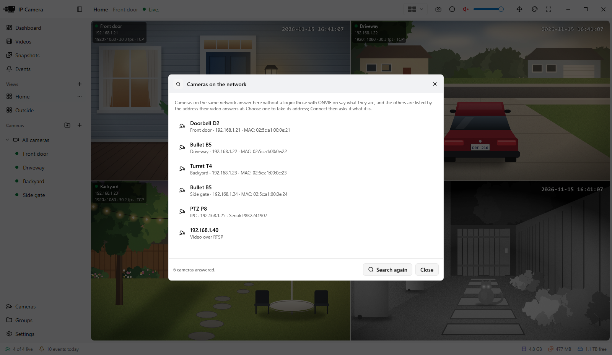

<p>
  <picture>
    <source media="(prefers-color-scheme: dark)" srcset="../../assets/brand/ipcamera/logo/ip-camera-horizontal-inverse.svg">
    
  </picture>
</p>

A desktop viewer for IP cameras, and a server that brings them to a browser.

<picture>
  <source media="(prefers-color-scheme: dark)" srcset="../../assets/screenshots/ipcamera-dark.png">
  
</picture>

IP Camera shows live RTSP video from several cameras in saved tile layouts, moves PTZ cameras, takes snapshots and
recordings, and logs what the cameras see, recording on motion and AI detections. It speaks Reolink's, Dahua's and
Amcrest's own APIs and ONVIF, and decodes H.264 and H.265 in Rust, so there's nothing to install alongside it.

<picture>
  <source media="(prefers-color-scheme: dark)" srcset="../../assets/screenshots/ipcamera-dashboard-dark.png">
  
</picture>

An event is something a camera saw (a person, a vehicle, an animal, a package, or motion), logged by day with the
snapshot and videos it saved, which play beside the list:

<picture>
  <source media="(prefers-color-scheme: dark)" srcset="../../assets/screenshots/ipcamera-events-dark.png">
  
</picture>

A network search finds cameras whose address you don't know, without logging in: cameras with ONVIF give their model
and name, and the rest are listed by the address their video answers on.

<picture>
  <source media="(prefers-color-scheme: dark)" srcset="../../assets/screenshots/ipcamera-search-dark.png">
  
</picture>

This README covers the product as a whole, for working on it: its crates, what it needs beyond the setup, running and
releasing it, how its code is organized, and what it saves. The rest is elsewhere:

| For | Read |
| --- | --- |
| Everything you see in the app | [`app/README.md`](app/README.md) |
| The server and its API | [`server/README.md`](server/README.md) |
| What IP Camera shares with the suite's other products: the styled controls, the themes, the settings files | [`crates/README.md`](../README.md) |
| Setting up a machine | the [root README](../../README.md#setup) |

**Contents:** [The crates](#the-crates) · [What it needs](#what-it-needs) · [Run it](#run-it) ·
[The web build](#the-web-build) · [Releases](#releases) · [How the code is organized](#how-the-code-is-organized) ·
[What it saves](#what-it-saves) · [Camera checks without the GUI](#camera-checks-without-the-gui)

## The crates

IP Camera is six crates, so the parts that neither draw nor decode can be built and tested on their own:

| Crate | Holds | Needs |
| --- | --- | --- |
| `crates/ipcamera/core` | Settings; cameras, groups and views; RTSP addressing; PTZ; Reolink's, Dahua's and ONVIF's APIs; watching cameras and the events they see; the server's JSON | nothing but Rust |
| `crates/ipcamera/dpapi` | DPAPI behind two safe calls, which `core` encrypts the cameras' passwords with; the root workspace's only `unsafe` | DPAPI |
| `crates/ipcamera/media` | The glass2glass pipeline: RTSP, decoding, sound and recording, or relaying the compressed video and decoding one picture on request; frames leave it as plain BGRA bytes | Rust only; the system's audio output at run time |
| `crates/ipcamera/storage` | Snapshots and recordings on disk: their names, PNGs, thumbnails, listing and folders, shared by the app and the server | Rust only |
| `crates/ipcamera/server` | `ipcamera-server`: the cameras' live video in a browser, relayed over WebSockets, with snapshots, recording and PTZ | Rust only; no display or sound device |
| `crates/ipcamera/app` | The app: its TSX interface, and the Rust that runs the cameras and draws the live picture | nsh 0.5.1 |

The app is a Cargo workspace of its own, so `cargo` at the repository root builds and tests only `core`, `dpapi`,
`media`, `storage` and `server`. `cargo test -p ipcamera-core` needs no decoder or display and runs in milliseconds.
The server depends on `core`, `media` and `storage`, and on nothing in the app. `media` depends on no UI: frames leave
it as bytes, and the app copies the newest one into a Direct2D bitmap.

## What it needs

Beyond the root README's setup, nothing is installed and nothing goes on `PATH` but `nsh`. Cargo builds the whole
camera path:

- **The pipeline:** [glass2glass](https://github.com/Glass2GlassHQ/glass2glass), a media pipeline written in Rust,
  whose RTSP source runs on [retina](https://github.com/scottlamb/retina).
- **H.264:** [rust_h264](https://github.com/roticv/rust_h264), on the CPU, rather than the system's decoder, which
  costs about 160 MB per camera through glass2glass's Media Foundation element.
- **H.265:** [rust_h265](https://github.com/roticv/rust_h265), from the same author, so the Microsoft Store's HEVC
  Video Extensions aren't needed.
- **Sound:** the system's audio output.

### When a camera won't play

The camera's status says why:

| Status | Cause |
| --- | --- |
| *the camera sends no H.264 or H.265 video* | The stream is MJPEG or another codec: set the camera's stream to H.264 or H.265 |
| *the pipeline could not agree on a picture or sound format* | Usually 10-bit, 4:2:2 or 4:4:4 video, which nothing here converts: set the camera to an ordinary 8-bit stream |
| *the camera would not set up the stream* | The camera answered but refused the stream: check the channel, the stream quality and any RTSP path override |
| *the camera rejected the username or password* | The login is wrong |

The first two and a rejected password stop the session at once: a retry would fail the same way, and repeated failed
logins can lock the camera's account. Anything else, such as a camera that's off the network, reconnects by itself,
up to 20 times.

## Run it

From `crates/ipcamera/app`, in PowerShell:

```powershell
nsh run
```

Or from the repository root:

```powershell
cargo ipcamera                # the same, passing on any arguments (cargo ipcamera --fps)
cargo package-ipcamera        # nsh package --target windows: crates\ipcamera\app\.nsh\out\ipcamera\ and ipcamera.zip
cargo package-ipcamera-web    # the web build, a static site for the server (server/README.md)
```

Arguments after either packaging command go to `nsh package` (`--app-version 1.2.0`). The first build compiles nsh's
runtime and the media stack and takes a few minutes; after that, builds take seconds. [The app's
README](app/README.md#run-it) covers the rest: running without a camera, the tests, the web preview and packaging.

## The web build

A browser can't open an RTSP connection to a camera, so the web build gets its cameras and their video from
`ipcamera-server` ([its README](server/README.md)). Without a server, it's a preview of the interface over a pretend
camera.

`nsh run --target web` needs two more things, once per machine: the `wasm32-unknown-unknown` target, and clang, which
`crates/ipcamera/app/tools/fetch-wasm-clang.ps1` fetches. The root README's setup has both commands
([The web build](../../README.md#optional-the-web-build)).

Clang is needed because this app has its own Rust crate, so its web runtime is built from source, and that runtime
includes `zstd-sys`, which is C. `cl.exe` can't compile to WebAssembly. A TSX-only app uses the prebuilt runtime that
comes with `nsh` and needs none of this. The compiler is too large to commit, so the script downloads a pinned release
(266 MiB, checked against pinned hashes) and keeps 143 MiB of it in `tools\llvm`, which git ignores.
`crates/ipcamera/app/.cargo/config.toml` points cargo at that folder. Nothing is installed system-wide and `PATH` is
left alone, so deleting `tools\llvm` undoes it. To update clang, change the version and hash at the top of the script,
delete `tools\llvm` and run it again.

| Symptom | Cause |
| --- | --- |
| `failed to find tool` naming `clang` or `llvm-ar` | The script hasn't been run on this machine |
| `Frame requires too much memory for decoding` | The system's `tar` was given LLVM's `.tar.zst` directly. It's compressed with a 1 GiB window, which `tar` refuses, so the script decompresses it with `zstd --long=30` |

## Releases

IP Camera's tags are `ipcamera-v<version>`, matching the version in `crates/ipcamera/app/nsh.json`. Push one:

```powershell
git tag ipcamera-v1.0.0
git push origin ipcamera-v1.0.0
```

then in the Actions tab, pick Release, press "Run workflow" and choose the tag under "Use workflow from".
[`crates/README.md`](../README.md#releases) covers the workflow, what a branch builds instead and how the jobs are
split.

The archive, `ipcamera-windows-x86_64-v<version>.zip`, holds `ipcamera.exe` with the `nsh` runtime folder beside it,
plus `LICENSE.txt` and `THIRD-PARTY-NOTICES.txt`. The media stack is compiled into the executable, so there's nothing
else to install.

## How the code is organized

The server's files are in [its README](server/README.md#how-it-is-organized), the app's in
[its README](app/README.md#how-it-is-organized), and `dp-store`'s, which `core` saves through, in
[`crates/README.md`](../README.md#dp-store). These are the libraries'.

### core

In `crates/ipcamera/core/src`.

| File | What it holds |
| --- | --- |
| `lib.rs` | The crate root, which re-exports the types everything is built from, whichever file holds them (`ipcamera_core::CameraConfig`, `Library`, `Change`, the ids); `api`, `config`, `ptz`, `rtsp_url` and `sync` stay namespaces of their own |
| `config.rs` | The settings file: `Config`, what it holds, and `ConfigStore`, which owns the file and says where the data folders are; loading and saving are `dp-store`'s |
| `ids.rs` | The ids that tie groups and views to cameras (`CameraId`, `GroupId`, `ViewId`): each a GUID in a type of its own, so the compiler refuses a group's id where a camera's belongs, and a plain string in the JSON files |
| `library.rs` | The only way the app reaches the cameras, groups and views: every read and change, deleting a camera everywhere, the first launch's Default view, and a snapshot of it all for the web build |
| `change.rs` | Every change to the cameras, groups and views as one value, `Change`, applied by `Library::apply`: the desktop applies it to its files, and the server to its own when the web build sends it |
| `camera_config.rs` | One camera's settings, `CameraConfig`, as the media and PTZ code sees them; `Stream`, its main or sub stream; and `validate`, the one check of whether it can be saved or played, whose `InvalidCamera` is the sentence the settings form shows |
| `camera_group.rs` | A named group of cameras (`CameraGroup`), which holds camera ids, never camera details |
| `camera_view.rs` | A saved view, `CameraView`: where each tile sits on its 12 × 12 grid (`Cell`, and the `Layout`s a view starts as), the fit for tiles that pick none, and in each tile a camera, its stream if not Auto, and its fit if it picks one (`ViewTile`, `TileStream`, `Fit`; `CameraView::fit_of`, `Fit::enlargement`) |
| `camera_store.rs` | Private, behind `Library`: `data\settings\cameras.json`, every camera entered once, in the order the app lists them |
| `group_store.rs` | Private, behind `Library`: `data\settings\groups.json`, camera groups that list cameras by id only |
| `view_store.rs` | Private, behind `Library`: `data\settings\views.json`, the saved views, which list cameras by id only |
| `records.rs` | What the three stores' lists share: an id per item, repairing blank or repeated ids, finding by id, a required name |
| `saved_password.rs` | Private: how `cameras.json` keeps a camera's password, encrypted for the user account by DPAPI as Base64, or as it is where there's no DPAPI; a value the account can't decrypt reads as none |
| `api.rs` | The rest of the server's JSON, which the server and the web build both read: its status, the saved files, its folders, and the requests to take a snapshot, record and move a camera |
| `rtsp_url.rs` | Building the RTSP URL |
| `ptz.rs`, `ptz/` | The velocity contract, Dahua command mapping and command queue, with the transport the camera's brand picks: for a Dahua, the DVRIP client in `ptz/dvrip.rs`, whose `DvripError` keeps a refused login apart from every other failure, or Dahua's HTTP API in `ptz/dahua_http.rs` with `http_api` on (Amcrest's light bulb cameras have no DVRIP); Reolink's API in `ptz/reolink.rs`; and ONVIF's PTZ service in `ptz/onvif.rs` for any other camera |
| `camera_features.rs` | What a camera does beyond its stream, in brand-neutral terms: what it says it is (`DeviceInfo`), what it has (`CameraFeatures`: motion, AI detections, a spotlight), what it sees now (`CameraActivity`) and its `Spotlight` |
| `reolink.rs`, `reolink/` | Reolink's HTTP API as data: the commands (motion, AI, spotlight, PTZ) and how to read their replies. `ReolinkClient` (`reolink/client.rs`) sends them over HTTPS, keeps the login (never retrying a refused one), and recognizes a Reolink without logging in. Also the web server's FLV streams, some of which its RTSP server lacks (Balanced, `ext`; a tracking lens's sub stream): their names, the header that says what each sends, which ones Detect lists (each name opened for its first bytes, skipping those RTSP already has and a second lens's other name), and the address the media code opens one at, with a login token instead of the password. Not in the web build |
| `dahua_http.rs` | Dahua's HTTP API on Dahua and Amcrest cameras, in either dialect, tried in this order: the CGI (`GET /cgi-bin/…`, `key=value` replies) or the XML API Amcrest Link's light bulb cameras speak (`POST /dev-api/…`, Amcrest's "AMLINK CGI"). The HTTP digest login (the password never sent, a refused login never retried), what the camera is (`magicBox.cgi`), PTZ (`ptz.cgi`, counting channels from 0 or 1 as the firmware does), and a white light in `Lighting_V2` (a bulb's or a floodlight's) or `coaxialControlIO.cgi`, never the infrared lamp. Not in the web build |
| `onvif.rs` | ONVIF, through the `oxvif` crate, which speaks the protocol (SOAP envelopes, WS-Security's and HTTP's digest logins, reading replies); each client runs that crate's async calls on a small tokio runtime of its own, on the calling thread. This file holds what the app asks and its own rules: what the camera is, where its services are (only the path of an address the camera gives is used), which event topics mean motion or a detection, a pull-point subscription that follows them (`OnvifEvents`), the streams it lists, PTZ moves, a light bulb camera's light among its PTZ service's auxiliary commands, and a refused login told apart from every other failure and never sent again. Also `discover`, which asks the network for ONVIF cameras (WS-Discovery, no login) for the camera form's network search. Not in the web build |
| `camera_search.rs` | `find_cameras`, the camera form's network search: ONVIF's discovery alongside a try of RTSP's port on each address of this machine's private networks (`OPTIONS`, no login), as one list by address. Not in the web build |
| `camera_detect.rs` | `detect`: which brand of camera is at an address (every port asked at once, none with a login), what it has, and whether its PTZ goes over DVRIP or its HTTP API, for the camera form. Not in the web build |
| `camera_watch.rs` | `CameraWatch`: one thread per watched camera (a Reolink over its API, a Dahua over its HTTP API, any other camera over ONVIF) that polls what it sees and switches its spotlight or light, for the desktop and the server alike. On the desktop it also turns what the camera sees into events, grouped within the window Settings sets, each starting with the camera's own picture where it hands one out (a Reolink's `Snap`), and tags what the app saves with what the camera saw. Not in the web build |
| `camera_event.rs` | `CameraEvent`: something a camera saw, from when it came into view until the grouping window after its last sighting passed, with the number of sightings and what the app saved. `EventTracker` turns a watch's answers into events: whatever the camera's AI tells apart, or motion for a camera that knows only motion. A sighting ends after ten seconds of nothing, the event after the window, and each answer gives an `EventStep` |
| `event_video.rs` | How an event's videos are made (`EventVideo`): Settings → Automation's for every camera, which a camera's own settings can replace as a whole. How long a video keeps recording after the camera last saw something, how much from before it starts with, when a long one continues in a new file, and which stream and kinds of detection it records |
| `event_log.rs` | `EventLog`: `data\events\events.json`, the newest thousand events, each naming the snapshot and videos it saved (`EventFile`), saved the same way as the settings |

### dpapi

| File | What it holds |
| --- | --- |
| `crates/ipcamera/dpapi/src/lib.rs` | `protect` and `unprotect`, DPAPI's `CryptProtectData` and `CryptUnprotectData` for the account running the program, and `DpapiError`; the decrypted copy DPAPI returns is wiped before it's freed |

### media

In `crates/ipcamera/media/src`.

| File | What it holds |
| --- | --- |
| `session.rs` | One session: its thread, reconnecting, volume, and which failures are never retried; RTSP, or a Reolink's FLV stream, which logs in for a token before the session's runtime starts |
| `error.rs` | `MediaError`: why a session, a pipeline or a still failed, with a rejected login and an unplayable stream kept apart from what a retry may fix |
| `pipeline.rs` | Asking the camera what it sends, and building the glass2glass graph for it, from RTSP or from an FLV stream |
| `flv.rs` | A Reolink's FLV stream: one API login for a token, the GET, its header as the offer (H.264 only, and AAC), a logout once it starts sending; and the source that hands its bytes to one `flvdemux` for the video and one for the sound |
| `avc.rs` | The H.264 decoder element, on `rust_h264`: each picture out as soon as its access unit is in, and B-frames put back in order |
| `hevc.rs` | The H.265 decoder element, on `rust_h265` |
| `gate.rs` | The decode gate: a live view nothing shows stays connected but decodes nothing, and catches up from the last keyframe when shown again |
| `sink.rs` | The picture-size tap, and the pipeline's last video element, which crops each picture and hands it to the frame slot |
| `tap.rs` | The element both the picture-size tap and the record taps are: it passes everything on and shows it to whatever watches |
| `frame.rs` | A decoded picture, and the slot that holds the newest one |
| `record.rs`, `record/` | Recording a camera as it plays: its stream copied into a fragmented MP4, with the file itself, and the length its header gets once it ends, in `record/mp4.rs` |
| `relay.rs` | Relaying a camera: its compressed video handed to any number of viewers, each starting at a keyframe |
| `still.rs` | One picture from a relay, decoded on request from the pictures since the last keyframe: a snapshot or a recording's thumbnail |
| `sizes.rs` | How large each of a camera's RTSP streams is, from the SDP it answers DESCRIBE with, for Detect: the streams nothing else sized, with the saved login, stopping at the first refusal |
| `annexb.rs` | Reading H.264 and H.265 access units: their NAL units, the parameter sets, and the codec string a browser decodes by |
| `pretend.rs` | The pretend camera, a test pattern served over RTSP, behind the `pretend-camera` feature |

### storage

In `crates/ipcamera/storage/src`.

| File | What it holds |
| --- | --- |
| `saved_file.rs` | How snapshots and recordings are named (an event's tagged with what the camera saw), found and listed |
| `snapshot.rs` | Writing a PNG, from a decoded picture or a camera's JPEG, and making any missing thumbnails |
| `recording.rs` | Naming a recording |
| `thumbnail.rs` | The small PNG of each that the pages show |
| `quota.rs` | What the snapshots and videos take together, and deleting the oldest to fit under a limit |
| `space.rs` | A drive's free space |
| `error.rs` | `StorageError`: why a file couldn't be found, written or deleted |

## What it saves

Everything sits beside the executable (under `nsh run`, that's `crates\ipcamera\app\target\debug`), never in
`%APPDATA%` or the user's profile.

| What | Where |
| --- | --- |
| The preferences | `settings.json` |
| The cameras, groups and views | `data\settings\cameras.json`, `groups.json` and `views.json` |
| Snapshots | `data\snapshots`, unless `storage` names another folder |
| Recordings | `data\videos`, unless `storage` names another folder |
| What the cameras saw | `data\events\events.json`, the newest thousand events |

`crates/ipcamera/core/src/config.rs` is the only writer of `settings.json`, and the files in `data\settings` go through
`Library`. Both save the same way (`dp-store`): atomically (temp file, then rename), and never over a file they
couldn't read.

### settings.json

The preferences. It's created from defaults on first launch, so you can inspect and edit it by hand:

```jsonc
{
  "ui": {},          // muted, volume, rail_collapsed, rail_width, sidebar_width, dark, follow_system, dark_theme, light_theme, texture, elevation (every product's, `dp_store::Appearance`), page, alerts, events_table_width
  "window": {},      // x, y, width, height, maximized
  "storage": {},     // snapshots, videos: folders to save in; empty for the defaults above
  "automation": {},  // log_events (on), event_capture (picture, video, picture_and_video or nothing; picture), event_window_minutes (5; 0: none), media_limit_mb, video_limit_mb (0: no limit), overwrite_oldest (off), event_video (below)
  "server": {}       // password: ipcamera-server's, as a salted hash (`--set-password`)
}
```

`event_video` sets how the videos events save are made (`ipcamera_core::EventVideo`). A number outside its range is
brought within it.

| Field | Default | Range or values |
| --- | --- | --- |
| `after_seconds` | 30 | 10 to 120 |
| `before_seconds` | 10 | 0 for none, else 5 to 30 |
| `longest_minutes` | 10 | 0 for no limit, else up to 60 |
| `motion_continues` | on | |
| `stream` | `own` | `own`, `main`, `sub` or a path the camera listed |
| `kinds` | all | `person`, `vehicle`, `animal`, `face`, `package` |

Settings in the app changes the snapshot and video folders (`storage`). The window reopens at its last size, position
and maximized state; a saved rectangle that would land off-screen is ignored and the window opens centered. It opens
on the page it closed on (`page`): the dashboard, a view, a camera, the Cameras or Groups page, the snapshots, the
videos or the events. If that view or camera has been deleted, it opens the first view.

### The cameras, groups and views

On first launch there are no cameras and an empty 2 × 2 view called Default. A view's tile is a camera's id, or
`{ "camera": "<id>", "stream": "sub" }` for a tile that shows another of the camera's streams (the app's README,
[Cameras, groups and views](app/README.md#cameras-groups-and-views)). A camera with event video settings of its own
has them as its `event_video`, in the same shape, in place of `settings.json`'s; other cameras have none. A camera
whose events are off has `"log_events": false`; the default is `true`.

What an event saves goes into the snapshots and videos folders with everything else, tagged with what the camera saw
(`snapshot-1762560000-<camera id>.vehicle.png`), and the event names those files (the app's README,
[Events](app/README.md#events)).

### The cameras' passwords

The app has to send each camera its password (DVRIP, Reolink's API, ONVIF and RTSP all log in with it), so it can't
keep a hash of it the way the server keeps its own password.

- `cameras.json` keeps each password encrypted by DPAPI for the user account that saved it, as Base64. The system
  holds the key, which comes from the account's logon; no key is in the code or in any file. A copy of the file or the
  folder anywhere else (another machine, another account, a backup, a synced folder, a bug report) gives no password
  away. A program running as the same account can still decrypt them, as the app does: DPAPI keeps the file from other
  people, not from malware running as you.
- **A password the account can't decrypt** (the folder was copied from another machine or account) reads as none: the
  camera waits for it to be entered again, and nothing logs in without it. The next save writes none in its place.
- **Without DPAPI**, the server keeps the passwords as they are, in a `cameras.json` only its owner can read or write
  (mode 0600).

A missing password is an empty value either way, so the file shows which cameras have one. The browser is never sent
one ([`server/README.md`](server/README.md)).

## Camera checks without the GUI

The `#[ignore]`d tests below talk to a real camera. They're the quickest way to tell "the camera moved" from "the UI is
wired wrong". Each reads its camera from environment variables: the first two fail without theirs, and the brand
tests say what to set and send nothing, never a blank or guessed login.

| Test | Variables | What it does |
| --- | --- | --- |
| `media::session::pulls_frames_from_a_real_camera` | `IPCAMERA_HOST`, `IPCAMERA_USER`, `IPCAMERA_PASSWORD` (`IPCAMERA_SUB=1` picks the sub stream) | Waits for a decoded frame and prints its size |
| `ptz::tests::drives_a_real_camera` | the same | Probes DVRIP, pans briefly and stops |
| `reolink_client` (`core/tests`) | `IPCAMERA_REOLINK_HOST`, `_USER`, `_PASSWORD` (`_PORT` 443, `_HTTPS` 1) | What a Reolink is, has and sees, changing nothing |
| `onvif_client` (`core/tests`) | `IPCAMERA_ONVIF_HOST`, `_USER`, `_PASSWORD` (`_PORT` 80, `_PATH`) | What an ONVIF camera is, its events, and ten seconds of what it sees |
| `dahua_http` (`core/tests`) | `IPCAMERA_DAHUA_HOST`, `_USER`, `_PASSWORD` (`_PORT` 80, `_HTTPS` 0) | Which ports a Dahua or Amcrest answers on (no login), Detect, then its HTTP API's model, PTZ, light and lighting tables, changing nothing |

```powershell
cargo test -p ipcamera-media pulls_frames_from_a_real_camera -- --ignored --nocapture
cargo test -p ipcamera-core drives_a_real_camera -- --ignored --nocapture
cargo test -p ipcamera-core --test reolink_client -- --ignored --nocapture
cargo test -p ipcamera-core --test onvif_client -- --ignored --nocapture
cargo test -p ipcamera-core --test dahua_http -- --ignored --nocapture
```

**When the app won't connect**, `diagnose_a_saved_camera` runs the first camera an app saved, with no reconnecting, so
the first failure shows with its reason. Point `IPCAMERA_SETTINGS_DIR` at that app's `data\settings` folder. It prints
what the camera offers, each status change and the first picture's size. `IPCAMERA_DIAGNOSE_SECONDS` keeps it running
and prints the frame rate every 5 s, and `G2G_DEBUG=*:warning` adds glass2glass's own log, including retina's
messages. The password goes only to the session and is never printed:

```powershell
$env:IPCAMERA_SETTINGS_DIR = "crates\ipcamera\app\target\debug\data\settings"
cargo test -p ipcamera-media diagnose_a_saved_camera -- --ignored --nocapture
```
