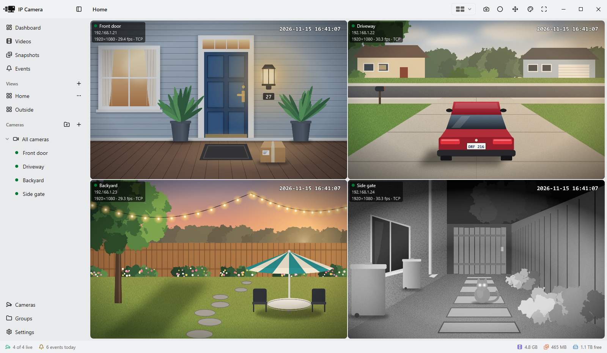
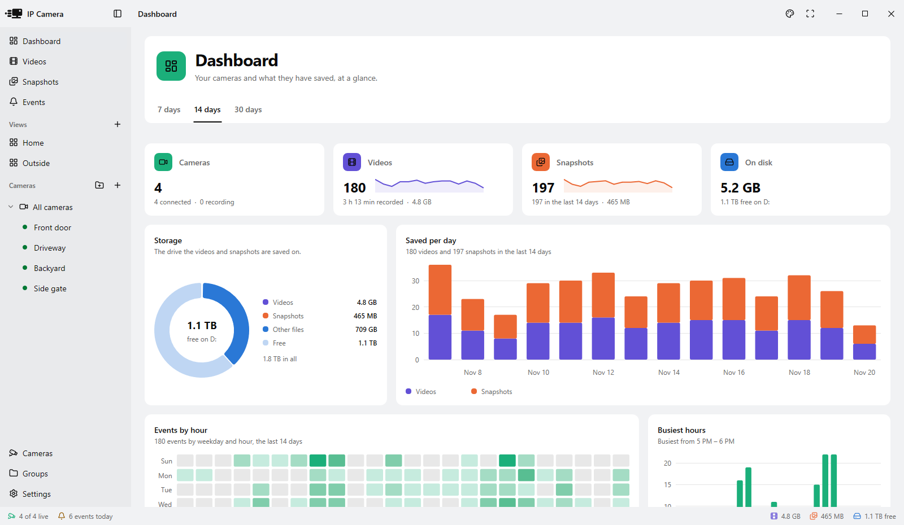
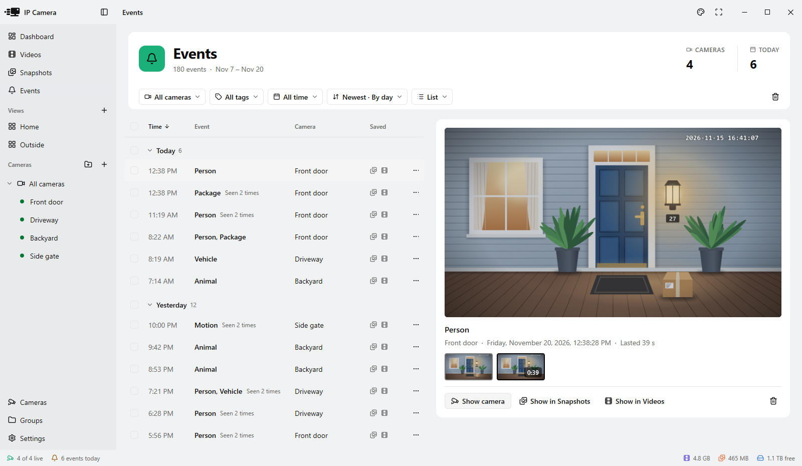

<p>
  <picture>
    <source media="(prefers-color-scheme: dark)" srcset="../../assets/brand/ipcamera/logo/ip-camera-horizontal-inverse.svg">
    
  </picture>
</p>

A desktop viewer for IP cameras, and a server that brings them to a browser.

<picture>
  <source media="(prefers-color-scheme: dark)" srcset="../../assets/screenshots/ipcamera-dark.png">
  
</picture>

IP Camera shows live RTSP video from several cameras in saved tile layouts, moves PTZ cameras, takes snapshots and
recordings, and logs what the cameras see, recording on motion and AI detections. It speaks Reolink's, Dahua's and
Amcrest's own APIs and ONVIF.

<picture>
  <source media="(prefers-color-scheme: dark)" srcset="../../assets/screenshots/ipcamera-dashboard-dark.png">
  
</picture>

An event is something a camera saw (a person, a vehicle, an animal, a package, or motion), with what it saved:

<picture>
  <source media="(prefers-color-scheme: dark)" srcset="../../assets/screenshots/ipcamera-events-dark.png">
  
</picture>

A network search finds cameras without logging in:

<picture>
  <source media="(prefers-color-scheme: dark)" srcset="../../assets/screenshots/ipcamera-search-dark.png">
  
</picture>

The app is in [`app/README.md`](app/README.md), the server in [`server/README.md`](server/README.md), what the suite
shares in [`crates/README.md`](../README.md), and setup in the [root README](../../README.md#setup).

## What it needs

Nothing beyond the root README's setup: cargo builds the whole camera path.
[glass2glass](https://github.com/Glass2GlassHQ/glass2glass) is the pipeline, its RTSP on
[retina](https://github.com/scottlamb/retina); [rust_h264](https://github.com/roticv/rust_h264) and
[rust_h265](https://github.com/roticv/rust_h265) decode on the CPU; sound goes to the system's audio output.

When a camera won't play, its status says why:

| Status | Cause |
| --- | --- |
| *the camera sends no H.264 or H.265 video* | MJPEG or another codec: set the camera's stream to H.264 or H.265 |
| *the pipeline could not agree on a picture or sound format* | Usually 10-bit, 4:2:2 or 4:4:4 video: set an ordinary 8-bit stream |
| *the camera would not set up the stream* | Check the channel, the stream quality and any RTSP path override |
| *the camera rejected the username or password* | The login is wrong |

The first two and a rejected password stop the session and are never retried, since failed logins can lock the
camera's account. Anything else reconnects by itself, up to 20 times.

## Run it

From the repository root:

```powershell
cargo ipcamera                # nsh run in crates/ipcamera/app, passing on any arguments (cargo ipcamera --fps)
cargo package-ipcamera        # nsh package --target windows: crates\ipcamera\app\.nsh\out\ipcamera\ and ipcamera.zip
cargo package-ipcamera-web    # the web build, a static site for the server
```

Arguments after either packaging command go to `nsh package` (`--app-version 1.2.0`). The app's README covers running
without a camera, the tests and the web preview.

## The web build

The web build gets its cameras and video from `ipcamera-server` ([its README](server/README.md)); without one, it's a
preview over a pretend camera.

`nsh run --target web` needs the `wasm32-unknown-unknown` target and clang, once per machine
([the commands](../../README.md#optional-the-web-build)), since the app's web runtime includes C (`zstd-sys`). On
Windows, `crates/ipcamera/app/tools/fetch-wasm-clang.ps1` puts a pinned, hash-checked clang in `tools\llvm` and points
cargo at it in `crates/ipcamera/app/.cargo/config.toml`; git ignores both, and deleting them undoes it. To update clang,
change the version and hash at the top of the script, delete `tools\llvm` and run it again. On Linux, cargo finds the
system's clang.

| Symptom | Cause |
| --- | --- |
| `failed to find tool` naming `clang` or `llvm-ar` | On Windows, the script hasn't run on this machine; on Linux, `clang` or `llvm` isn't installed |
| `Frame requires too much memory for decoding` | The system's `tar` was given LLVM's `.tar.zst` directly; the script decompresses it with `zstd --long=30` |

## Releases

Tags are `ipcamera-v<version>`, matching `version` in `crates/ipcamera/app/nsh.json`:

```powershell
git tag ipcamera-v1.0.0
git push origin ipcamera-v1.0.0
```

Then in the Actions tab, pick Release, press "Run workflow" and choose the tag under "Use workflow from"
([`crates/README.md`](../README.md#releases) has the rest). The archive, `ipcamera-windows-x86_64-v<version>.zip`,
holds `ipcamera.exe` with the `nsh` runtime folder beside it, `LICENSE.txt` and `THIRD-PARTY-NOTICES.txt`.

## How the code is organized

| Crate | Holds | Needs |
| --- | --- | --- |
| `core` | Settings; cameras, groups and views; RTSP addressing; PTZ; Reolink's, Dahua's and ONVIF's APIs; watching cameras and their events; the server's JSON | Rust only |
| `dpapi` | DPAPI behind two safe calls, for the cameras' passwords; the root workspace's only `unsafe` | DPAPI |
| `media` | The glass2glass pipeline: RTSP, decoding, sound, recording, relaying | the system's audio output |
| `storage` | Snapshots and recordings on disk, for the app and the server | Rust only |
| `server` | `ipcamera-server` ([its files](server/README.md#how-it-is-organized)) | no display or sound device |
| `app` | The app: its TSX, and the Rust that runs the cameras and draws the live picture ([its README](app/README.md)) | nsh |

The app is a workspace of its own; `cargo` at the root builds the other five. `cargo test -p ipcamera-core` needs no
decoder or display. The server uses nothing of the app's, and `media` no UI: frames leave it as BGRA bytes. Each
file's module doc (`//!`) says what it holds; `dp-store`, which `core` saves through, is in
[`crates/README.md`](../README.md#dp-store).

- **`core`**: `library.rs` is the only way to the cameras, groups and views, `change.rs` every change to them, and
  `config.rs` the only writer of `settings.json`. Its root re-exports its types (`ipcamera_core::CameraConfig`,
  `Library`, `Change`); `api`, `config`, `ptz`, `rtsp_url` and `sync` stay namespaces. The brands' clients
  (`reolink.rs`, `dahua_http.rs`, `onvif.rs`), the network search, Detect and the watch aren't in the web build.
- **`media`**: `session.rs` runs a camera on a thread of its own, `pipeline.rs` builds its graph, `avc.rs` and
  `hevc.rs` decode, `gate.rs` stops decoding while no tile shows it, `record.rs` records, and `relay.rs` and
  `still.rs` serve the server. The pretend camera is `pretend.rs`, behind the `pretend-camera` feature.

## What it saves

Everything sits beside the executable, never in `%APPDATA%` or the user's profile. Under `nsh run` it's in
`crates\ipcamera\app\target\debug\.nsh` ([why](../README.md#workarounds-for-nsh-061)).

| What | Where |
| --- | --- |
| The preferences | `settings.json` |
| The cameras, groups and views | `data\settings\cameras.json`, `groups.json` and `views.json` |
| Snapshots | `data\snapshots`, unless `storage` names another folder |
| Recordings | `data\videos`, unless `storage` names another folder |
| What the cameras saw | `data\events\events.json`, the newest thousand events |

Every file is saved atomically, never over one that couldn't be read.

### settings.json

Created from defaults on first launch; it can be edited by hand.

```jsonc
{
  "ui": {},          // muted, volume, rail_collapsed, rail_width, sidebar_width, dark, follow_system, dark_theme, light_theme, texture, elevation (every product's, `dp_store::Appearance`), page, alerts, events_table_width
  "window": {},      // x, y, width, height, maximized
  "storage": {},     // snapshots, videos: folders to save in; empty for the defaults above
  "automation": {},  // log_events (on), event_capture (picture, video, picture_and_video or nothing; picture), event_window_minutes (5; 0: none), media_limit_mb, video_limit_mb (0: no limit), overwrite_oldest (off), event_video (below)
  "server": {}       // password: ipcamera-server's, as a salted hash (`--set-password`)
}
```

`event_video` sets how events' videos are made; a number outside its range is brought within it.

| Field | Default | Range or values |
| --- | --- | --- |
| `after_seconds` | 30 | 10 to 120 |
| `before_seconds` | 10 | 0 for none, else 5 to 30 |
| `longest_minutes` | 10 | 0 for no limit, else up to 60 |
| `motion_continues` | on | |
| `stream` | `own` | `own`, `main`, `sub` or a path the camera listed |
| `kinds` | all | `person`, `vehicle`, `animal`, `face`, `package` |

The window reopens at its last size and place (centered, if that would be off-screen) on the page it closed on, or the
first view if that view or camera is gone.

### The cameras, groups and views

On first launch there are no cameras and an empty 2 × 2 view called Default. A view's tile is a camera's id, or
`{ "camera": "<id>", "stream": "sub" }` for another of its streams
([Cameras, groups and views](app/README.md#cameras-groups-and-views)). A camera with its own `event_video` uses it in
place of `settings.json`'s, and `"log_events": false` turns its events off. What an event saves is tagged with what the
camera saw (`snapshot-1762560000-<camera id>.vehicle.png`) ([Events](app/README.md#events)).

### The cameras' passwords

`cameras.json` keeps each password encrypted by DPAPI for the user account that saved it, as Base64: a copy of the file
elsewhere gives no password away, though a program running as the same account can decrypt them. A password the
account can't decrypt reads as none, and the camera waits for it to be entered again. Without DPAPI, the server keeps
them as they are, in a `cameras.json` only its owner can read or write (mode 0600). The browser is never sent one.

## Camera checks without the GUI

These `#[ignore]`d tests talk to a real camera named by environment variables. The brand tests say what to set and
send nothing without it, never a blank or guessed login.

| Test | Variables | What it does |
| --- | --- | --- |
| `media::session::pulls_frames_from_a_real_camera` | `IPCAMERA_HOST`, `IPCAMERA_USER`, `IPCAMERA_PASSWORD` (`IPCAMERA_SUB=1` for the sub stream) | Waits for a decoded frame and prints its size |
| `ptz::tests::drives_a_real_camera` | the same | Probes DVRIP, pans briefly and stops |
| `reolink_client` (`core/tests`) | `IPCAMERA_REOLINK_HOST`, `_USER`, `_PASSWORD` (`_PORT` 443, `_HTTPS` 1) | What a Reolink is, has and sees, changing nothing |
| `onvif_client` (`core/tests`) | `IPCAMERA_ONVIF_HOST`, `_USER`, `_PASSWORD` (`_PORT` 80, `_PATH`) | What an ONVIF camera is, its events, and ten seconds of what it sees |
| `dahua_http` (`core/tests`) | `IPCAMERA_DAHUA_HOST`, `_USER`, `_PASSWORD` (`_PORT` 80, `_HTTPS` 0) | A Dahua's or Amcrest's ports (no login), Detect, then its HTTP API's model, PTZ and light, changing nothing |

```powershell
cargo test -p ipcamera-media pulls_frames_from_a_real_camera -- --ignored --nocapture
cargo test -p ipcamera-core drives_a_real_camera -- --ignored --nocapture
cargo test -p ipcamera-core --test reolink_client -- --ignored --nocapture
cargo test -p ipcamera-core --test onvif_client -- --ignored --nocapture
cargo test -p ipcamera-core --test dahua_http -- --ignored --nocapture
```

**When the app won't connect**, `diagnose_a_saved_camera` runs the first camera saved in the `data\settings` folder
`IPCAMERA_SETTINGS_DIR` names, without reconnecting, and prints what the camera offers, each status change and the
first picture's size, never the password. `IPCAMERA_DIAGNOSE_SECONDS` keeps it running with the frame rate every 5 s,
and `G2G_DEBUG=*:warning` adds glass2glass's own log.

```powershell
$env:IPCAMERA_SETTINGS_DIR = "crates\ipcamera\app\target\debug\.nsh\data\settings"
cargo test -p ipcamera-media diagnose_a_saved_camera -- --ignored --nocapture
```
