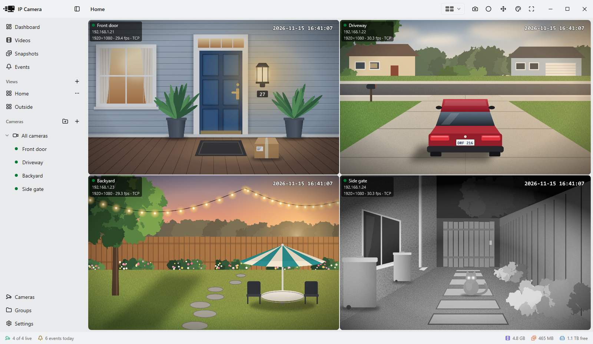
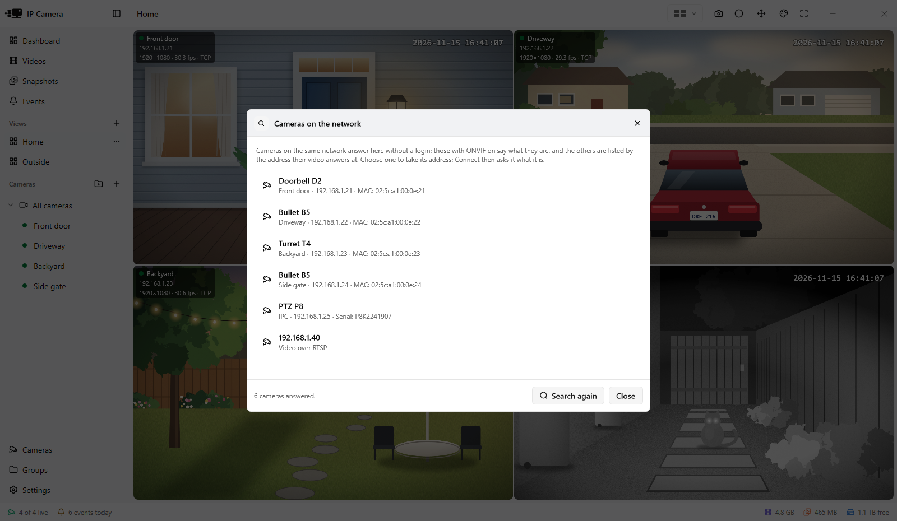
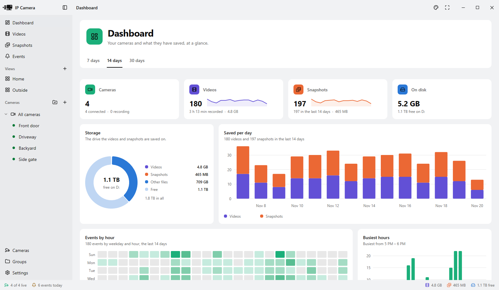
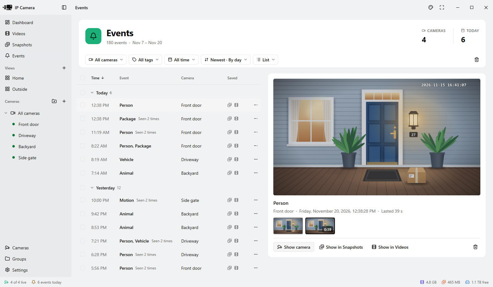

<p>
  <picture>
    <source media="(prefers-color-scheme: dark)" srcset="../../../assets/brand/ipcamera/logo/ip-camera-horizontal-inverse.svg">
    
  </picture>
</p>

The IP Camera app: everything you see in it.

<picture>
  <source media="(prefers-color-scheme: dark)" srcset="../../../assets/screenshots/ipcamera-dark.png">
  
</picture>

The app is built on [nsh](https://github.com/longbridge/nsh) with the suite's UI and themes (`crates/dp/ui`). The
interface is TSX, and this folder is also a Rust crate that holds the camera code and draws the live picture. It's a
Cargo workspace of its own, so `cargo` at the repository root doesn't build it.

| For | Read |
| --- | --- |
| IP Camera as a whole: its crates, what it needs, releasing it and what it saves | [IP Camera's README](../README.md) |
| The server and its API | [`server/README.md`](../server/README.md) |
| The controls, themes and workarounds the suite's products share | [`crates/README.md`](../../README.md), [its workarounds](../../README.md#workarounds-for-nsh-061) |
| Setting up a machine | the [root README](../../../README.md#setup) |

**Contents:** [Run it](#run-it) · [How it is organized](#how-it-is-organized) ·
[Cameras, groups and views](#cameras-groups-and-views) · [The Cameras page](#the-cameras-page) ·
[The Groups page](#the-groups-page) · [Dashboard](#dashboard) · [Snapshots](#snapshots) · [Events](#events) ·
[Recording and videos](#recording-and-videos) · [Live video](#live-video) · [Settings](#settings) · [Tests](#tests) ·
[The web](#the-web) · [The window](#the-window)

## Run it

```powershell
nsh run
```

On first launch there are no cameras. Add one with the **+** in the sidebar and enter its password; from then on the
app connects by itself. Cameras are saved in `data\settings\cameras.json` beside the executable, each password
encrypted for your user account ([What it saves](../README.md#what-it-saves)). Under `nsh run` that folder is
`target\debug\.nsh\data\settings`, which git ignores.

To work without a camera, set `IPCAMERA_SOURCE` and the app shows a moving 1080p test picture. Nothing reaches a
camera, PTZ included:

```powershell
$env:IPCAMERA_SOURCE = 'pattern'
nsh run
```

With the test picture, `IPCAMERA_PICTURES` names a folder where a camera named like a PNG (`Front door.png`) shows that
picture and says it's live, and `IPCAMERA_FOUND` names a JSON file of `ipcamera_core::FoundCamera`s (as the server's
`/api/discover` returns them) for the network search to list. The READMEs' screenshots are taken this way
(`cargo screenshots`, [`crates/README.md`](../../README.md#screenshots)).

The test picture can't be recorded. To try recording without a camera, run the pretend camera and add a camera at
`127.0.0.1`, RTSP port `8554`, RTSP path `/stream`:

```powershell
cargo run -p ipcamera-media --features pretend-camera --example pretend_camera -- 8554 20
```

Only one `nsh` development session runs at a time: starting `nsh run --target web` ends a running `nsh run`.

## How it is organized

| Path | Holds |
| --- | --- |
| `App.tsx` | The shell: the window's state, its panels and its shortcuts |
| `views/model.ts`, `actions.ts` | What every region reads; what buttons and menus do |
| `views/stage.tsx`, `picture.tsx`, `arranger.tsx`, `ptz.tsx` | The video stage, a camera's picture, the layout editor, the PTZ panel |
| `views/cameras.tsx`, `settings.tsx`, `finder.tsx`, `bulk.tsx` | The Cameras page, a camera's dialog, the network search, editing several cameras |
| `views/groups.tsx`, `members.tsx` | The Groups page and a group's dialog |
| `views/dashboard.tsx`, `gallery.tsx`, `videos.tsx`, `events.tsx` | The dashboard, snapshots, videos and events pages; `library.ts` and `grid.tsx` are what the last three share |
| `views/preferences.tsx`, `automation.tsx` | Settings and its Automation section |
| `src/bridge.rs` | Everything TSX can call |
| `src/camera.rs`, `src/camera/`, `src/web_backend.rs` | The desktop's backend, and the web's against `ipcamera-server` |
| `src/library.rs`, `form.rs`, `form_check.rs` | What both backends share: groups, views, the camera form and its checks |
| `src/video.rs` | The component that draws the live picture with Direct2D |
| `icon.png` | The app icon, rendered from `assets/brand/ipcamera/ip-camera-app-icon.svg` |

## Cameras, groups and views

### The sidebar

Under Dashboard, Videos, Snapshots and Events, the sidebar lists the views, then the cameras, all of them and by group;
only the cameras scroll. Cameras, Groups and Settings stay at the bottom. Drag the sidebar's edge to resize it, from
180 to 400 points (`sidebar_width` in `settings.json`, 232 at first; the web build doesn't keep it). Its button,
Ctrl+B, or a window under 640 points hides it.

Each camera, view and group row has a menu, from its `…` or a right press. A group's opens its dialog, renames it,
adds or removes cameras, shows them on the Cameras page, duplicates it, moves it up or down, and deletes it.

### The cameras' order

All cameras keeps the order of `cameras.json`, which every camera list starts from. Drag a row by its grip to move it,
or use its menu (up, down, to the top or bottom); Alt+Up and Alt+Down move the camera open on its own. The list doesn't
scroll while a row is dragged to its edge, so move a camera farther with its menu. A group's cameras keep the order its
dialog sets.

### The files

Each kind is saved in a JSON file of its own in `data\settings`. Groups and views refer to cameras by id, so a camera
is entered once however many groups and tiles show it:

| File | Holds |
| --- | --- |
| `cameras.json` | Every camera's settings |
| `groups.json` | Named groups, each a list of camera ids. A camera can be in several |
| `views.json` | Saved views: each tile's cells on the 12 × 12 grid, its camera id, its stream when it picks one, its fit when it picks its own; the view's fit for the rest |

### A view's layout

A view's tiles sit on a 12 × 12 grid, each at least 2 × 2 cells, none overlapping. The layout menu in the header
offers Single, 2 side by side, 2 stacked, 1 large + 2 beside, 1 large + 2 below, 2 × 2, 1 large + 5, 1 large + 7,
3 × 3 and 4 × 4, and checks the one the tiles match. A layout with fewer tiles keeps the hidden tiles' cameras for when
there's room again.

The first launch makes an empty 2 × 2 view called Default. An empty tile's Add camera lists the cameras, then New
camera…; with no cameras yet, it opens the new camera's form at once.

### Editing a layout

*Edit layout…*, in the layout menu and a tile's menu, shows each tile as a frame on the grid over its live picture.
Drag a frame to move it, or a corner or edge to resize it; it lands on the nearest cells, or goes back if it would cover
another tile. A frame's × removes its tile (not the last); *Add tile* adds one in the first free space, 4 × 4, else
3 × 3, else 2 × 2; a layout picked from the menu lays the draft out that way. *Done* (Return) saves; *Cancel*
(Escape), or leaving the view, discards. A layout moved off a preset is the view's own, and the menu checks none.

### Tiles

A tile's fit is Original (the whole picture), Fill (cropped to fill), Stretch, or a forced 1:1, 4:3, 3:4, 16:9 or
9:16, from Fit on its toolbar or in its menu. A tile keeps its fit through a new camera, stream or place; one with none
shows the view's. A camera on its own is Original until one is picked, and its fit and stream last until the app
closes.

A press selects a tile, and another unselects it. A view opens with none selected; then the header names no camera,
the PTZ panel asks for one, and no stream is heard. A double click fills the stage with a tile, and another puts it
back. A camera shown on its own has a tile's badges, toolbar and menu.

### Auto

A tile, or a camera on its own, plays Auto until it picks a stream. Auto plays the smallest stream the picture is drawn
no more than a quarter larger than, else the largest: a 4 × 4 view on a 1080p screen plays each camera's sub stream,
and a camera filling the stage its main stream. It counts device pixels, zoom and fit, stays on the lens of the
camera's own stream, and switches only once a new size has held for half a second. A camera's Auto tiles in one view
share the stream the largest needs.

Auto chooses only among streams Detect has sized. A camera with one stream, or none sized, plays its own stream; one
whose streams aren't sized yet needs Connect in its dialog once.

### Picking a stream

Stream, in a tile's menu or toolbar, lists Auto, then each of the camera's streams once: its own, marked *(default)*,
which follows the camera's settings; the main and sub stream at a Dahua's or a Reolink's paths; and the streams Detect
found, by size, codec and name (`1920×1080 · H.264 · main`), largest first, under a heading for each lens. Only the
stream belongs to the tile: the address, login and PTZ stay the camera's. `views.json` keeps a tile on Auto as the
camera's id, and a picked stream as `{ "camera": "<id>", "stream": "sub" }` (`own`, `main`, `sub`, or a listed path).

A tile switching streams keeps the old picture until the new one's first arrives, for ten seconds at most, and says
what's coming (`Waiting for 896×512…`).

### What streams follows what is on screen

- A stream shown or kept connects by itself when its camera has a password, unless the user pressed Disconnect; one
  that's neither disconnects. Only the selected tile's stream is heard.
- Tiles on two streams of a camera are two connections; tiles on one stream share it.
- Connect starts the camera's streams on screen, or its own stream; Disconnect stops them all.
- The header, the PTZ panel and the stats follow the selected tile.
- A recording is of the camera's own stream, which stays connected for it until the recording stops.
- A snapshot is of the camera's own stream where a tile shows it, else of the selected tile's.

The kept cameras are the last view's and every camera opened on its own since, whatever page is open. They stay
connected but aren't decoded while no tile shows them, so their picture is back at once; the network still carries
their whole stream. Opening another view starts over, and the rest disconnect.

### Over the picture

A chip at the top left shows the camera's name and status, its address, the picked stream, and the shown stream's
size, frame rate and transport; other badges show the spotlight, recording, and what the camera sees. On the web the
chip has only the address.

The toolbar, on the picture under the pointer or the selected tile, has the stream picker, the spotlight, a snapshot,
Record (which records that camera, and while it records stops every recording), Fit, sound, Open on its own (in a
tile), Connect or Disconnect (for every tile of that camera), and More. Under 340 points wide it keeps only the stream
and More. More, or a right press, opens Stream, Fit, Connect or Disconnect, and Edit camera….

## The Cameras page

**Cameras**, at the bottom of the sidebar, or the dashboard's Cameras number, is a table of every camera. Its header
counts them, the groups, the cameras in no view and those with no password.

- **Search and filters**: the search keeps cameras with every typed word in their name, address (port included),
  username, RTSP path or groups; the filters pick a group (or *In no group*), a status (*Needs a password*, *Has a
  problem*, *Connected*, *Recording*) and a stream (main or sub). *Add camera* opens a new camera's dialog.
- **The table**: a row per camera in the order added, with its status, name, address, channel, stream and transport,
  username or *No password*, and groups; a narrow window drops the groups, then the login, then the stream. A column
  title sorts by it, then the other way, then back; numbers sort by value (Camera 2 before Camera 10). The pencil or a
  double click opens a camera's dialog, and its `…` its menu.
- **Pages** of 25 rows (or 10, 50, 100), counted in the footer ("11–20 of 42 cameras") with the selection. A new
  search, filter, order or page size goes back to the first page.
- **Selecting** works as in Explorer: a press, Control, Shift, or a checkbox, and the titles' checkbox for the page.
  Control+A selects all the filters keep, on every page; Delete deletes after asking, Return edits and Control+D
  duplicates, none of them while typing or in a dialog. A camera a filter hides leaves the selection. The selection's
  bar, or a right press, offers *Edit*, *Duplicate*, *Groups* (into or out of a group, or *New group…*) and *Delete*.
- **Duplicate** copies a camera's address, login, stream, ports and groups onto the next channel its address doesn't
  use, as "Garage copy", then "Garage copy 2". To set up a recorder, enter channel 1, duplicate it once per channel and
  rename the copies.

### A camera's dialog

A camera's settings open in a dialog with the parts *Connection*, *Stream*, *PTZ*, *Features* and, on the desktop,
*Events*, which gives the camera event video settings of its own ([Events](#events)). It opens on *Connection*.

**Connect** asks the camera what it is (Detect, below). A new camera's other parts open once it has been asked, filled
in with what it said, or anyway if it didn't answer. *Add* waits until the camera has been asked at the address and
login the form holds, and until then Return asks it; after a failed Connect it becomes *Add anyway*, which only a
press takes. A saved camera's *Save* is on whenever something changes, and PTZ uses the saved settings from its next
move.

A field with a problem says so, its part is marked, and *Save* waits until it's fixed. *Cancel*, Escape, the close
button and a press outside discard the edits.

### Brands and Detect

**The brand** (Dahua / Amcrest, Reolink or Other) decides the RTSP path a blank override stands for and how PTZ,
motion and a spotlight are reached:

- a Dahua's PTZ over DVRIP, or, with *PTZ and its light over its HTTP API* on, its PTZ and white light over Dahua's
  HTTP API;
- a Reolink's PTZ, motion, AI detections and spotlight over its own HTTP API;
- any other camera's PTZ over ONVIF.

*Features* names the APIs' port and scheme. Amcrest's light bulb cameras (RTSP path `/live1`) have no DVRIP: they're
Dahuas with the HTTP API on. The app never switches Dahua's older lighting table, which is the infrared lamp's on most
cameras. A camera that names no brand is a Dahua.

**Detect** asks the camera its brand without logging in, then logs in with the form's password and fills in the form:
a Reolink's model, firmware and what it has; a Dahua's model, firmware, PTZ and light; and for anything but a Reolink,
ONVIF's make, model, events, PTZ and light, on the camera's ONVIF port or the ports cameras ship it on. It turns *PTZ
and its light over its HTTP API* on for a Dahua whose DVRIP is closed or that has a light there, and *Watch it over
ONVIF* on for a camera that reports motion or has a light. The app keeps no list of models.

- *Watch it over ONVIF* stays off until you or Detect turn it on, since a failed ONVIF login counts against the
  account.
- When ONVIF refuses a login the camera accepts another way, Detect doesn't try ONVIF again until the address, the
  login, or the ONVIF port or path changes. A refused login ends Detect.
- When nothing answers, Detect says which ports were open; only the video's means the camera has no local API.
- On the test picture, in tests and in the web preview, Detect says it reaches no camera, which counts as an answer.
- What Detect found has a copy button, since the dialog's text can't be selected.

### Searching the network

The magnifier in the dialog's header opens *Cameras on the network*: the cameras that answer ONVIF's discovery within
about three seconds, by model, name and address, then those that answer only on RTSP's port (554), as *Video over
RTSP*. Choosing one takes its address and ports, and its name if the form has none, and Detect then fills in its brand
without logging in. *Search again* asks once more. Only cameras on the same network answer (on the web, the
server's), so type the address of one that doesn't show up.

<picture>
  <source media="(prefers-color-scheme: dark)" srcset="../../../assets/screenshots/ipcamera-search-dark.png">
  
</picture>

### Editing several cameras

With several cameras selected, *Edit* opens the dialog without the name, the channel, *Features* and *Events*. A field
shows the shared value or *Mixed*; a change applies to all of them, and its undo button lets each keep its own. The
password is never shown; typing one sets it for all. *Apply* saves all or none in one write, and reconnects only the
changed cameras' streams.

### A camera's streams

Detect, with a login, asks which streams the camera has (its ONVIF profiles, or a Reolink's API). The *Stream* part
offers those; choosing one saves its path as the camera's RTSP path, its default stream. A camera's first list starts
on the stream that has played so far, or else the largest of the main lens's. Where nothing lists the streams, Detect
tries the camera's own and a Dahua's or Reolink's main and sub paths, one at a time, stopping at the first refused
login, and lists them when it finds two. Only a camera that lists no streams shows *Stream quality* and *RTSP path
override*.

A Reolink sends some streams only as FLV (Balanced, `ext`, and a tracking lens's `autotrack_sub`). Detect lists those
that send H.264, at paths like `flv:channel0_ext.bcs`, played over the API port. Whether a stream is H.264 or H.265 is
the camera's own setting: the app plays either.

## The Groups page

**Groups**, at the bottom of the sidebar, is a table of every group, with the Cameras page's pages, selection and keys.
Its header counts the groups, the cameras in a group and in none, and the empty groups.

- The search keeps groups with every typed word in their name or their cameras' names; the filters pick a camera and a
  status (*Has a problem*, *Needs a password*, *Recording*, *Empty*). *New group* opens a new group's dialog.
- A row per group, in the sidebar's order: its name, how many cameras, which ones, and what they're doing (*2 of 3
  connected*). Sorting by status puts problems first, and empty groups go last.
- Return opens a group's dialog. The selection's bar offers *Cameras* (into or out of every selected group),
  *Duplicate* and *Delete*; deleting several is all or none, and their cameras stay.
- *Duplicate* (also Control+D) copies a group with its cameras in order ("Outside copy").
- A row's menu is the sidebar's; *Move up* and *Move down* are left out while a column sorts.
- A group's dialog has its name, its cameras in order (moved up, down or out), and the other cameras under a search,
  each added with *+*. The sidebar's *New group* asks only for a name.

## Dashboard

<picture>
  <source media="(prefers-color-scheme: dark)" srcset="../../../assets/screenshots/ipcamera-dashboard-dark.png">
  
</picture>

**Dashboard**, at the top of the sidebar, sums up the cameras, what they've saved and what they've seen, over the 7,
14 or 30 days its tabs pick.

- **Four numbers**: the cameras, connected and recording; the videos, with their length and size; the snapshots, with
  those in the period; and the space both take, with the drive's free space. Each opens its page; the disk opens
  Settings on General.
- **Storage**: a ring for each drive under the folders: the videos, the snapshots, other files and free space.
- **Saved per day**: each day's videos and snapshots, stacked. The pointer, or the arrow keys, picks out a day.
- **Events by hour**: a cell for each hour of each weekday, fuller the more events started in it.
- **Busiest hours**: the same hours over all weekdays, with the busiest named.
- **Latest events**: the five newest. A press shows one in the events page's preview; **Show all** opens that page.
- **Space by camera**: what each camera's files take, largest first; deleted cameras' files share one row.

On the web the event cards are left out, since only the desktop keeps the event log, and the drives are the server's.
The files are reread whenever a folder changes, and every few seconds while a camera records. The charts use the
theme's chart colors: `chart-1` the videos, `chart-2` the snapshots, `chart-3` the cameras and events, `chart-4` the
drive.

## Snapshots

The camera button in the header saves the newest frame of every connected camera on screen, all taken at the same
moment; with none connected, it says why. Each is a PNG in the snapshots folder (`data\snapshots` beside the
executable, unless Settings names another), named `snapshot-1762560000-<camera id>.png`: by id, so renaming a camera
keeps its snapshots. A PNG put there by hand is listed as *Unknown camera*, and a deleted camera's as *Deleted camera*.
Each gets a 480-pixel-wide thumbnail in `thumbnails` inside the folder; one without shows an icon until the app makes
it.

### The gallery

**Snapshots**, in the sidebar, shows the gallery: the count, the stats (cameras, this month's pictures, size on disk),
and the filters (camera, tag, date, order and grouping), which stay as the header collapses. Pictures are grouped by
month, day or camera under headings that fold. A picture opens at full size: the arrow keys step, Delete deletes after
asking, Escape closes. Its menu also shows it in Explorer, narrows to its camera, or shows the event that took it.

The gallery checks its folder every second, so changes made in Explorer appear by themselves. Deleting is for good,
not to the Recycle Bin. The filters, order, size and selection aren't saved.

### Tags

An event's snapshots and videos are tagged, in their names, with what the camera saw, and show it over the picture
(`Vehicle`). The Tag menu keeps all of them, those taken by hand, those from events, or one tag. An event's Show in
Snapshots or Show in Videos narrows the page to its files (*One event*) until the filters are cleared.

### Sizes and selecting

The View menu shows pictures Large, Medium (the default), Small or as a List, each page with its own. Selecting works
the same on the snapshots, videos and events pages: the ring in a picture's corner, Control or Shift; once anything is
selected, a press selects rather than opens. A heading's checkbox selects its section, and Control+A all the filters
keep. The selection's bar has *Select all*, *Delete (3)* and a clear button (Escape). Deleting asks once; one that
fails says why, and the rest still go.

## Events

<picture>
  <source media="(prefers-color-scheme: dark)" srcset="../../../assets/screenshots/ipcamera-events-dark.png">
  
</picture>

While *Events* is on in Settings → Automation (it is unless turned off), what the cameras see is logged, on screen or
not. An event is something a camera's AI tells apart (a person, a vehicle, an animal, a face, a package), or motion
for a camera that knows only motion. A camera with AI logs nothing on plain motion, which trees, rain and shadows set
off all day.

### Grouping

A sighting lasts until the camera has seen nothing for ten seconds, or for *Keep recording* while events save videos,
so each sighting is one video; `Now` shows meanwhile. With *Motion* on, plain motion keeps a sighting the AI started
going for up to two minutes after the AI last saw something, but never starts one.

An event stays open for *Group within* (five minutes by default) after its last sighting, so a car that pulls in,
waits and leaves is one event, with one picture and one alert (`Seen 3 times`). Each camera has its own events. *Don't
group* ends an event with its sighting. Changing the window or the event videos restarts every watch, ending what was
open; a camera's own settings restart only its watch.

A camera's Events part can turn its events off: no events, alerts or event files, and the camera is asked what it sees
only while it streams.

### What an event saves

Settings' *Save* picks a picture (the default), a video, both, or nothing. The picture is taken as the event starts,
from the camera itself (a Reolink, at its main stream's size), else from the screen, else from the camera's own stream,
a few seconds late; a camera the user disconnected, or with no password, goes without. A video records each sighting,
by Settings' *Event videos* or the camera's own:

- *Keep recording* (10 seconds to 2 minutes; 30 seconds): how long it records after the camera last saw something.
- *Start before* (Off, or 5 to 30 seconds; 10): the video starts that long before, from a keyframe. The stream stays
  connected around the clock for this, holding up to 32 MB, which costs its bandwidth and one of the camera's
  connections; off, the first seconds can be missed.
- *Longest video* (No limit, or 1 minute to an hour; 10 minutes): a longer one continues in a new file, losing nothing.
- *Motion* (on): plain motion holds a video open between detections.
- *Stream* (the camera's own): which stream the videos record.
- *Save videos of* (all): what the camera has to see for a video; every event is still logged. A camera that knows
  only motion records motion regardless.

A recording already running is left alone, and one the user started never stops for an event. Event files go in the
snapshots and videos folders, under the limits, named with what the camera saw
(`snapshot-1762560000-<camera id>.vehicle.png`, `video-1762560000-<camera id>.person.vehicle.mp4`, `motion` for a
motion-only camera). A video is renamed when it closes to carry everything seen while it recorded, unless a player has
it open.

### The log

The log keeps the newest thousand events in `data\events\events.json`; one that goes to make room leaves its files. An
event still going on when the app closes ends where it started, and one whose camera stops being watched ends then.

### The Events page

**Events**, in the sidebar, lists events like the snapshots (header, filters, grouping, sizes, selecting) but opens as
a log: a row each under day headings, with Time (which sorts), Event, Camera and Saved. A row shows what was seen
(`Seen 6 times`, `Now`), the camera, and marks for its picture and videos.

Where there's room, a card beside the table shows the pressed event (the first until one is pressed; Up and Down
step): its picture, which opens full size, or a video, which plays when pressed; what, which camera, when, how long
(`Lasted 2 min 48 s`) and how many times; a strip of its files; and Show camera, Show in Snapshots, Show in Videos and
Delete. Drag the line between them to resize the table (`events_table_width` in `settings.json`; the web forgets it on
reload). On a narrower page, a press selects the row.

A double press, or a press at a picture size, opens what the event saved: its picture in the viewer, else its videos.
Its menu also shows its files, the camera, or that camera's events, or deletes it. Deleting asks first when the event
saved files, naming them, since they go too (but not a recording still being written). The header's bin deletes every
event that has ended, after asking; one still going on can't be deleted.

### Alerts

As an event starts, a message at the bottom right says what and where (`Person at Backyard.`), with Show, which opens
the camera: once per event. What the log held when the app opened isn't news. Settings → Automation turns alerts off
(`alerts` in `settings.json`). The messages show only inside the app.

The web has no event log: the server keeps none, and the page says the desktop app logs them.

## Recording and videos

The round button beside the snapshot button records every connected camera on screen; with none connected, it says
why. It turns red while anything records, and pressing it then stops every recording, from any page. A recording
camera shows REC on its tile and a red dot in the sidebar, as **Videos** does. It stays connected off screen until the
recording stops or the user disconnects it. A recording that can't write its file (a full disk, say) stops and says
why.

### Automation

Settings → Automation (`automation` in `settings.json`) is off until turned on, except *Events*:

- *Events* (`log_events`, on) watches every camera the app can and logs what each sees ([Events](#events)). Off, a
  camera is watched only while it streams, for its badge and spotlight, and nothing is logged, alerted or saved.
- *Save* (`event_capture`) is what each event saves ([What an event saves](#what-an-event-saves)).
- *Event videos* (`event_video`), shown while events save videos, is how they're made for cameras without their own.
  A camera's own are its `event_video` in `cameras.json`, where `"log_events": false` turns its events off.
- *Group within* (`event_window_minutes`, 5; 0 is *Don't group*) is how long what a camera sees joins the same event.
- *All media* caps the snapshots and videos together (not the thumbnails). At the cap a snapshot or recording is
  refused with the reason, and recordings stop; *Make room* instead deletes the oldest files, for good, until the rest
  fit, never a video still being written.
- *Video file size* continues a recording in a new file at the next keyframe once its file reaches it.

On the web the section isn't shown: the server records without the limits.

### The files

A recording is the camera's own stream (or, for an event, the stream its event video settings pick), copied without
re-encoding into a fragmented MP4 in the videos folder (`data\videos` beside the executable, unless Settings names
another), named like a snapshot: `video-1762560000-<camera id>.mp4`. H.264 or H.265 video goes in with AAC sound;
cameras with G.711 sound record only their picture. A file cut short by a crash still plays up to its last second. A
new file starts when the stream reconnects, when the picture changes size, or at *Video file size* or *Longest video*.
Each recording also gets a thumbnail in `thumbnails` inside the videos folder.

### The Videos page

**Videos**, in the sidebar, lays the recordings out like the snapshots, by day until another grouping is picked, each
with its length. One in progress shows REC and can't be played or deleted until it stops. A recording opens in the
system's player over the window: the arrow keys step, Delete deletes after asking, Escape closes. Its menu also shows
it in Explorer. Deleting is for good, thumbnail included.

## Live video

The app draws the live picture itself, with Direct2D (`src/video.rs`), so controls draw over it. H.264 and H.265
decode in Rust and sound plays through WASAPI, so nothing needs installing
([What it needs](../README.md#what-it-needs)). A frame's work happens once per stream, however many tiles show it.

### A picture that isn't live

A stream that loses its camera keeps its last picture, dimmed, with what happened:

- *Not connected*, and why, with Connect, or the camera's settings when it needs a password.
- *Connection lost* (*Can't reach the camera* if it never had a picture), the attempt, and when the last picture came.
  It reconnects by itself.
- *Stream stopped*, when it gave up for good (a stream the app can't play, a camera that never came back, *Reconnect
  by itself* off), with Try again.
- *Login refused*, with the camera's settings, so the same password isn't sent again.

Each tile reports the stream it shows. On the web the server's player says the same.

### Zoom

The wheel over a picture zooms up to 8 × around the pointer, and a precision touchpad zooms as smoothly. Each tile
zooms on its own. The chip shows how far in it is (`2.4×`), and the toolbar's Show all goes back. Drag a zoomed
picture to look around; a picture that isn't zoomed takes no drag. A new camera or stream starts whole, and the zoom
isn't saved. The web build has no zoom.

### What a camera sees

A Reolink with a password, a Dahua with *PTZ and its light over its HTTP API* on, and any other camera with *Watch it
over ONVIF* on are watched while the app runs, on screen or not, while events are logged (otherwise only while the
camera streams). A camera about to connect waits for its stream to go live first, so a wrong password costs one failed
login, not two. A camera that refused a login isn't watched or connected by itself until its settings change.

About once a second the watch asks a Reolink over its API, its spotlight too, and any other camera for its ONVIF
events. A Dahua's white light is checked every five seconds over its HTTP API; switching it sets it to `Manual` or
`Off`, and one left in `Auto` reads as off. A light bulb camera's light is switched over ONVIF, which can't say
whether it's on, so the switch shows how it was last set.

A tile shows what the camera sees at the bottom left (`Person, Vehicle`, else `Motion`), and a spotlight's switch at
the top right. It comes from the camera, not from the picture. On the web the server watches.

## Settings

**Settings**, at the bottom of the sidebar, opens a dialog over the page. Each setting saves as it changes. Escape, a
press outside, the close button and Done close it. It reopens on the section you left; the dashboard's disk and the
status bar's drive open it on General, and the status bar's media gauge on Automation.

- **General**: where new snapshots and videos are saved (`storage` in `settings.json`). *Change…* opens the system's
  folder dialog; *Use default* goes back to the folder beside the app. A folder the app can't write to is refused when
  chosen. Saved files stay where they are, and the videos folder can't change while a camera records.
- **Automation**, on the desktop: events, alerts, what events save, and the storage limits ([Automation](#automation)).
  A limit set by hand in `settings.json` shows among the menu's sizes.
- **Appearance**, shared by every product: the mode (Light, Dark or System), the texture (None, Haze or Dots), the
  elevation (None, Soft or Raised), and a theme for each appearance ([Themes](../../README.md#themes)). Default
  follows the mode. System switches between the dark and light picks with the system. Changing the mode never changes
  a pick.

The palette icon in the title bar has the mode and the themes for the appearance shown. The choices are saved in
`settings.json`'s `ui` as `dark`, `follow_system`, `dark_theme`, `light_theme`, `texture` and `elevation`, Default as
`default-dark` or `default-light`. A fresh install follows the system, with Default, no texture and no elevation.

## Tests

```powershell
nsh test
```

This runs the Rust tests, then every `*.test.ts(x)` file headless, with throwaway settings and no way to reach a
camera.

| Test | What it covers |
| --- | --- |
| `App.test.tsx` | The app as a whole: the Cameras and Groups pages, the dialogs, and the pages that open empty |
| `Brand.test.ts` | The shared controls' and Markdown's colors against their surfaces in every theme |
| `Cameras.test.ts`, `Groups.test.ts` | Each page's search, filters, order and selection |
| `Settings.test.ts`, `Finder.test.ts` | A new camera's Add button; how a camera found on the network is listed |
| `Layouts.test.ts`, `Sidebar.test.tsx` | Editing a layout; reordering All cameras |
| `Notice.test.ts` | What covers a picture that isn't live |
| `Snapshots.test.ts`, `Recordings.test.ts`, `Events.test.ts` | Each page's filters, grouping, labels and menus, on made-up data |
| `Dashboard.test.ts`, `Automation.test.ts` | The dashboard's sums and the page the app reopens on; Automation's menus |

- A test gets no file system, so `App.test.tsx` opens the gallery, videos and events empty; don't widen the app's
  `capabilities` for a test. The files are tested in `crates/ipcamera/storage`, `crates/ipcamera/media` and
  `crates/ipcamera/server/tests`.
- The dialogs show one part at a time, so a test presses a part by its id (`id:section:stream`) before its fields.
- A run's tests share preferences, so `App.test.tsx`'s `start` goes to the Default view first.

```powershell
$env:IPCAMERA_SOURCE = 'pattern'
nsh test <file>.test.tsx --target windows
```

This is the real app in a real window: without `IPCAMERA_SOURCE` it connects to the camera. Name a test file; the
headless tests fail there. Headless tests read a model, not the screen, so after a change to the window or drawing,
launch the app and look.

## The web

`nsh run --target web` needs [the web build's setup](../README.md#the-web-build). A browser can't open RTSP, so
`ipcamera-server` connects to the cameras and keeps the library ([its README](../server/README.md)), and the web build
is its client:

- It reads a copy of the server's library and sends every change to it, with the desktop's rules and messages.
  Another browser's changes arrive within a second.
- It's never told a password: the form leaves it empty, which keeps the saved one.
- Its tiles show the server's player (`/watch?camera=<id>`) under this machine's other name (`127.0.0.1` for a page
  opened as `localhost`): a frame of the app's own origin loses its origin, and the browser then refuses its
  connection to the server.

The server serves the packaged web build at its own address (`cargo package-ipcamera-web`, with `.nsh\out\web` copied
to `web` beside the server). `nsh run --target web` serves on port 8787, so set `IPCAMERA_SERVER` and start the server
with `--allow-origin` for that page; `cargo ipcamera-web` and `.claude/launch.json` start both that way. With no
server, the web build is a preview with one pretend camera, forgotten on reload; its gallery and videos are empty, and
snapshots, recording and PTZ say they need the server or the desktop app.

With a server, snapshots, recording and PTZ keep the desktop's buttons and rules, and the server does the work:

- A PTZ move stops unless sent again within a second, so a page that goes away can't leave the camera turning.
- The gallery and videos list the server's files. Its folders can't be opened or chosen from a browser, so a file's
  menu has "Open in a new tab" in place of "Show in Explorer".
- A camera with no saved password isn't tried, live video included, until someone presses Connect. A camera the
  server gave up on reads as not connected, with the reason, and Connect tries again.
- Sound needs the desktop app.

A server with a password (`ipcamera-server --set-password`) shows a sign-in page, and Settings has Sign out. The
session is kept in memory only, so a reload asks again.

The app draws its menus in a browser, with the desktop's items. Ids made in the browser are counted rather than
random, since randomness there needs JavaScript glue. A browser decodes H.265 only with a hardware decoder: the page
says so, and the camera's H.264 sub stream plays everywhere. Still to do: HTTPS before the server listens beyond this
machine, sound, and choosing the server's folders.

## The window

The header and the sidebar's top row are the title bar, with the system's minimize, maximize and close buttons. The
app opens on the page it closed on (`page` in `settings.json`'s `ui`), or the first view if that one is gone. The
smallest window is 200 × 150. One-off messages show as toasts.

The status bar shows how many cameras are live, how many record, and on the desktop the day's events, each opening its
page; then the space the videos and snapshots take and the drive's free space, which open Settings. Under a media
limit, those give way to a gauge, amber from 90%, which opens Settings on Automation.
