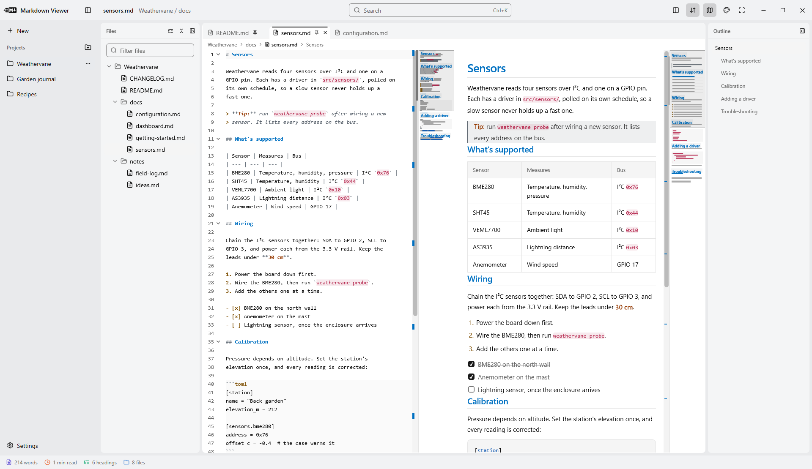

<p>
  <picture>
    <source media="(prefers-color-scheme: dark)" srcset="../../assets/brand/mdviewer/logo/md-viewer-horizontal-inverse.svg">
    
  </picture>
</p>

A desktop reader for folders of Markdown: notes, documentation, a repository's READMEs.

<picture>
  <source media="(prefers-color-scheme: dark)" srcset="../../assets/screenshots/mdviewer-dark.png">
  
</picture>

Markdown Viewer opens folders as projects and reads their Markdown files in tabs, each raw, rendered or both side by
side, with its outline, a map of the whole file, and a search across the project. It shares the suite's UI and themes
(`crates/dp/ui`).

- It reads; it doesn't edit ([Not yet](#not-yet) lists what else it doesn't do).
- "Markdown Viewer" is its name for now, and its logo says "MD Viewer"; the folder, the crates and the nsh package are
  `mdviewer`.

It's two crates: `app`, the nsh app, and `core` (`mdviewer-core`), its plain Rust. What it shares with the suite's
other products (the styled controls, the themes, the settings files) is in [`crates/README.md`](../README.md), and
setting up a machine is in the [root README](../../README.md#setup).

**Contents:** [Run it](#run-it) · [The window](#the-window) · [Keys](#keys) · [Projects](#projects) ·
[The files panel](#the-files-panel) · [Tabs](#tabs) · [Raw, Split and Rendered](#raw-split-and-rendered) ·
[Search](#search) · [The outline](#the-outline) ·
[The scroll bars and the heading rail](#the-scroll-bars-and-the-heading-rail) · [The map](#the-map) ·
[Settings](#settings) · [What it saves](#what-it-saves) · [Releases](#releases) · [How the code is organized](#how-the-code-is-organized) · [Not yet](#not-yet)

## Run it

From `crates/mdviewer/app`:

```powershell
nsh run       # a window, with hot reload
nsh test      # the crate's `cargo test`, then the *.test.ts(x) files headless
nsh check     # cargo check, then TypeScript's type check
nsh package   # .nsh\out\mdviewer\
```

Or `cargo mdviewer` and `cargo package-mdviewer` from the repository root. Only one `nsh run` goes at a time, so
starting this one ends IP Camera's, and the other way round. A change to `crates/dp/ui` reaches the app on its next
build.

## The window

Left to right:

- **The sidebar**: New, then Projects (the folders opened so far, newest first, each by its folder's name), and
  Settings at the bottom, which opens in a dialog over the window ([Settings](#settings)). A project's `…` (or a right
  click) opens it, shows its folder in Explorer, or removes it from the list, leaving its folder and files as they are.
  A narrow window hides the sidebar by itself.
- **The header**, which is the title bar, over the rest: the name of the file in front, its project and folder, the
  [search](#search), then how its tab shows it, the theme menu, and full screen.
  - The search sits centered in the space between the name and the buttons. When space runs short, the project and
    folder give way first, then the search, down to 160 points; the file's name keeps its width, and a window too
    narrow for both moves the buttons to a line of their own underneath.
  - How the tab shows is one icon for the current mode (Raw, Split or Rendered), whose menu picks another.
  - The theme menu starts with the mode (Light, Dark or System), the same as Settings' and saved with it, then lists
    the themes for the appearance that mode shows, each with a miniature window, for switching quickly (picked and
    saved as in Settings).
- **The files panel**: the project's Markdown files, with a filter ([The files panel](#the-files-panel)).
- **The tabs**, one per open file, and under them **the breadcrumbs**, the path to **the file** in front, which comes
  next ([Tabs](#tabs)).
- **The outline** beside the file ([The outline](#the-outline)).
- **The status bar**, under everything: the file's word count and reading time, its headings (a press shows the
  outline), its project's file count, what the search found, and in Raw, where the caret is.

The files panel, the file with its tabs, and the outline are islands (`Island` in `crates/dp/ui`): rounded blocks on
the frame, which is the sidebar's color, a gap apart and a gap from the frame's edges. They stand apart in three tiers
in every theme: the frame, the files panel and outline one step off it, and the file a step further, in the theme's
own page color ([`crates/README.md`](../README.md#islands) explains how the tiers are chosen). Drag the gap between
the files panel and the file to resize the panel; a grip shows there under the pointer.

The files panel's header, the tab strip and the outline's header form one row of equal height, in the tool panes'
color (in Wrap, below, the strip grows a row for each row of tabs). The tabs stand on the strip's bottom edge, a
little shorter than it; the tab in front is a card in the file's color with rounded top corners, joined to the
breadcrumbs and the file under it. The files panel and the outline each hide from a button in their own header, and
the button that brings one back waits at the end of the tabs on its side. A window too narrow for all three hides the
outline first, then the files panel. Full screen keeps only the file and its outline.

## Keys

| Keys | What they do |
| --- | --- |
| Ctrl+B | Hides or shows the sidebar |
| Ctrl+E | Steps the file in front through Raw, Split and Rendered |
| Ctrl+W | Closes the tab in front, pinned or not, or the results' tab |
| Ctrl+Shift+T | Reopens the last closed tab |
| Ctrl+Tab, Ctrl+Shift+Tab | The next tab and the one before, wrapping around |
| Ctrl+K, Ctrl+F | Open the search's drop-down |
| F3, Shift+F3 | The next match and the one before, across files |
| F11 | Full screen, as nsh has it; Escape leaves it |
| Return, in the files panel | Opens the file kept, as a double press does |
| Ctrl+click, Shift+click, in the files panel | Picks another file, or every file shown from the last one pressed |
| Ctrl+click, on a link | Opens its file kept, in a tab of its own |

The search's drop-down has keys of its own ([Search](#search)).

## Projects

A project is a folder, opened from New with Choose folder (the system's folder picker) or by dropping it anywhere on
the window. A folder already in the list moves to the top and opens; dropping a file instead of a folder asks for a
folder. The open project, and each project's tabs and front tab, are saved, so the window reopens where it was left.

A project's files are every `.md`, `.markdown`, `.mdown`, `.mkd`, `.mkdn` and `.mdx` file in the folder and its
subfolders, listed in each folder files first, then subfolders, each by name. Hidden folders (`.git`), `node_modules`
and `target` are skipped, and links to other folders aren't followed, since they could loop. The list stops at 5,000
files and says so.

The folder is listed again every two seconds, off the main thread, so a file added, renamed or deleted in another
program shows up by itself, and a tab whose file was deleted closes. The file in front is checked every second and
reloads when it changes on disk, as when it's saved in an editor. A project with no tabs opens its README (else its
first file) as the preview. A folder that's gone says so, with a button that removes the project.

## The files panel

The button at the left of the panel's header picks how the files are listed, and shows the current view's icon:

- **View as Tree** (the default): the project's own folder at the top, by name, with its folders nested under it as
  they are on disk, each opening and closing.
- **View as Folder**: a heading for each folder that holds files: the project's own first, by name, with its files,
  then each folder by its full path (`docs/api`), with its files under it.
- **View as List**: every file by name, with its folder beside it.

The project's own folder gets a row of its own so that a project with no folders still shows as a tree and the three
views look different. Every folder starts open, including ones that appear later, and stays as you left it until
another project opens. The view is saved with the preferences. "Collapse all" closes every folder in the folder view,
and every folder in the tree except the project's own. Typing in the filter lists the files whose path contains what
you typed, in any view. The file in front is shown in the panel, with its parent folders opened.

A press on a file opens it as the preview ([Tabs](#tabs)); a double press, or Return, opens it kept. Ctrl+click adds a
file to the picked ones or removes it, and Shift+click picks every file shown from the last one pressed; neither opens
anything. With two or more picked, a bar at the bottom of the panel opens them all in tabs, as does a right click on
one of them. Otherwise, a file's right-click menu opens it, opens it in a new tab, or shows it in Explorer.

The panel is nsh's `Tree`, which keeps the arrow keys, Home, End, typeahead and Return, and renders only the rows in
view. It selects one item only, so the rows handle their own presses, which say which keys were held, and the panel
tracks the picked files (`TreeList`'s `marked` and `onPress`, in `crates/dp/ui/tree.tsx`). The arrows move one row;
Shift with an arrow doesn't pick a range.

## Tabs

Each open file is a tab over the reader. A new tab opens after the one in front, with pinned tabs first. The tabs are
saved with the project, including which are pinned, the preview and how each shows its file, and a tab closes by
itself when its file is deleted. The logic is `views/tabs.ts`, and the strip is the suite's `FileTabs`
(`crates/dp/ui/tabs.tsx`).

A tab shows a file icon and the file's name, then the search's count while there is a search, then a pin and a ×. The
tab in front is a card in the file's color with the theme's tab line along its top, inset from its rounded corners;
the tab under the pointer takes the theme's hover color in the same shape; the others are just their names on the
strip, a little apart.

- **The preview.** A file opened with a single press (in the panel, or by a link) replaces the preview tab, its name
  in italics, instead of opening another, so browsing through files leaves one tab. A double press on the file or the
  tab keeps it, as do pinning it and its menu's Keep open. Ctrl+click on a link opens its file kept, in a tab of its
  own, like the file's menu's Open in a new tab.
- **Pinning.** The pin beside a tab's × pins it. It shows, quieter, on the tab in front and the one under the pointer,
  and always on a pinned tab, in the icons' own color, where it unpins. A pinned tab moves to the end of the pinned
  tabs, at the start of the strip, and stays open when the others close. Unpinned, it goes first among the others.
- **Closing.** The × on the tab in front or under the pointer, or Ctrl+W, closes it, pinned or not; the next tab comes
  to the front, else the one before. Ctrl+Shift+T reopens the last closed tab. The pin and the × keep their space while
  hidden, so a tab is the same width under the pointer and away from it.
- **Moving.** Drag a tab along the strip to move it: among the pinned tabs if it's pinned, among the others if not
  (`reorder.tsx`, which IP Camera's sidebar uses to drag its cameras too).
- **Its menu**, from a right click: Keep open (on the preview), Pin or Unpin, Close, Close others, Close to the right,
  Close all but pinned, Show in files and Show in Explorer.
- **Two files with the same name.** Two `README.md` tabs both say `README.md`; each one's folder is in its tooltip and
  in what a screen reader says, and the breadcrumbs name the front one's.
- **Tabs that don't fit** ([Settings](#settings)): **Scroll**, the default, keeps them in one row that scrolls
  sideways. **Wrap** gives them as many rows as they need, with the strip growing to hold them; a tab is dragged along
  its own row there, not to another (its drag follows one axis), and the tab in front joins the file only from the last
  row.

Each tab shows its file its own way, Raw, Split or Rendered, picked from the header's menu; a new tab uses the mode
Settings gives. A tab brought to the front starts at its file's top. nsh's presses don't say which mouse button was
pressed, so a middle click doesn't close a tab as it does in a browser.

### The breadcrumbs

`Breadcrumbs` in `crates/dp/ui/breadcrumbs.tsx` is a quiet bar under the strip, in the file's color with a panel line
under it: the project's name, each folder down to the file, and the file itself, emphasized, with a chevron between
steps (`pathSteps` in `views/tabs.ts`); then the heading the reader is under, as the outline marks it.

- The project and each folder that holds files of its own list those files on a press (not those of their
  subfolders), with the one in front checked; a file picked there opens as the preview, as a press in the files panel
  does. A folder that holds only folders is plain text.
- The heading lists the file's headings, and picking one goes there, as in the outline.
- While the results' tab is in front, the bar shows the project, then Search.
- When space runs short, each step shortens its name.

## Raw, Split and Rendered

### Raw

nsh's code editor, read-only: the Markdown as written, with line numbers and soft wrap. Each heading folds the text
under it, down to the next heading of its level or higher (`foldRanges` in `views/document.ts`); otherwise the editor
would fold by indentation, which Markdown has little of.

Raw is colored in the theme's syntax colors (`syntax-*`, each theme its own). `mdviewer-core` reads the file (`marks`
in `syntax.rs`, on pulldown-cmark, as the outline is read) and says what each part of its text is, and the raw view
lays a decoration over each (`views/syntax.ts`):

- Markdown's own punctuation is quieted (a heading's `#`s, `**`, backticks, a link's brackets, a fence, a table's
  pipes), so the words stand out.
- Headings and strong text are bold in their colors; emphasis and quotes are italic in theirs.
- Inline code sits on a tint of its color.
- A link's text is set apart from its target, which is underlined.
- List markers, task boxes and a quote's `>` take the marker color.
- Struck-through text is struck through.
- Each code block and the front matter have a band behind their lines. The code inside a fenced block keeps the
  editor's own colors, which nsh 0.5.1 sets the same in every theme.

### Rendered

nsh's `TextView`: CommonMark and GitHub's Markdown (tables, task lists, footnotes, alerts), inline HTML, and code blocks
highlighted with a copy button, in the theme's colors. Its parts take the same syntax colors as Raw (`PAGE` in
`views/syntax.ts`): headings, with a line under the top two levels; strong and emphasized text; inline code on a tint;
links, which show the pointing hand and their target when the pointer rests on one; list markers; quotes, their bar
and tint in the quote color; and outlined code blocks.

- Front matter (`---` at the start) shows as a quiet box of its own rather than a rule and a heading.
- A picture's relative path is resolved from its file's folder in the project.
- A link to a heading in the file goes there, a link to another Markdown file in the project opens it (in a tab of its
  own with Ctrl+click), and any other link opens outside the app.
- Formulas show as their TeX source, since nsh 0.5.1 draws none without an app's own renderer.

Both views, and every other list in the window, use the suite's scroll bars (`SCROLLBARS` in `crates/dp/ui`, which
`App.tsx` sets for every scroll view): always shown while there's more than fits, and 14 points wide with a 10-point
thumb, so they're easy to grab.

### Split

Both side by side; drag the line between them to share the width. The two scroll together while the header's toggle
is on (its arrows, shown in Split; on at first, and not saved yet while it's being tried out): whichever side you
scroll leads and the other follows (`views/scrollsync.ts`).

They line up by shared places rather than by fraction of length, since a code block or table is taller on one side
than the other: the top, each top-level heading (its line in Raw, its section on the page) and the end, with each side
following in proportion between two places. So the two meet at every heading and drift apart at most within a
section, where a tall code block or table can put them a little out of step until the next heading. The places are
measured again when a scroll starts after a pause (a fold in Raw moves them) and when either side changes size. The
outline takes both sides to a heading, and they leave each other alone while it does.

## Search

The box in the title bar shows the search and where the reader is among the matches (`2 / 12`). The × beside it ends
the search and clears its marks.

### The drop-down

Pressing the box, or Ctrl+K or Ctrl+F, opens the drop-down under it (`views/searchbar.tsx`, nsh's `Command` in a
`Popover`):

- **The field**, which searches once typing pauses, and three toggle buttons: Match case, Whole words (a word is
  letters, digits and `_`), and Regular expression, in Rust's `regex` syntax.
- **Where to look**: This file, Open tabs, Project (the default), or All projects, the open one first.
- **The matches**, a section for each file (its name, its folder, its project if it's another, and the count), each
  match showing its line number and the words around it, with the match marked. The drop-down lists the first 500;
  the files panel lists them all.
- **The keys** at its foot:

  | Keys | What they do |
  | --- | --- |
  | Up, Down | Move through the matches |
  | Return | Goes to the match and closes the drop-down |
  | Ctrl+Return | Shows the matches in the files panel (as does the button beside the keys) |
  | Tab | Moves the keyboard on to the buttons and the scope; the field keeps Tab for that, rather than stepping through the scopes as an editor's would |
  | Escape | Closes the drop-down, keeping the search |

  Open in a tab gives the matches [a tab of their own](#the-results-tab). Moving over a match doesn't open its file:
  nsh 0.5.1's `Command` doesn't say whether the keys moved the highlight or new matches arrived, so the file in front
  would change with every key typed.

### How it finds

The search matches what Raw's own search matches, since Rust does the finding with the crate nsh's editor uses
(`search.rs` in `mdviewer-core`): case-insensitive unless asked, by Unicode case folding (`É` finds `é`), with `^` and
`$` at each line. It runs off the main thread and stops at 10,000 matches across all the projects it searches. A new
query or scope cancels the previous search, and files are searched again within two seconds of changing. An invalid
pattern says why.

### The files panel's results

While the search has a query, the files panel lists what it found: each file with matches and its count, opening into
its matches, each with its line number and the words around the match, under a row per project when searching every
project. A press on a match, or the arrow keys, go there. The button in the panel's header shows every file again,
those with no match faded, and back; ending the search restores the panel.

### The results' tab

Open in a tab, in the drop-down or the files panel's header (`views/results.tsx`), is for a search with more results
than a list shows well. The tab comes after the file tabs, named for the search, and belongs to the window alone: it's
never saved with the project's tabs, follows the search as you type and as files change, and goes when the search
ends.

- Under the query, the scope and the count, each file has its row (its name, its folder, its project if it's
  another, and the count), then its matches in context, each with two lines above and below, line numbers beside
  them, the matches marked, and `⋯` where lines are skipped between them.
- A press on a line goes to its match, or the nearest, in its file; the tab stays open behind it.
- A file's row folds it, and Collapse all folds them all; past the first 30 files they start folded, and a file shows
  its first 50 blocks of lines.
- The lines are read from the file when it opens (`Search.context`), and again when the search finds something new in
  it.
- While the tab is in front, the outline's pane lists the files in the results, and a press there goes to one; Ctrl+W
  closes the tab.

### Where the matches show

The marks, the counts and F3 go by the open project's matches; a match in another project (All projects) opens that
project at the match. Matches are marked wherever a file shows:

- **The files panel**, in every view, and **the tabs**: each file's match count beside its name.
- **Raw**: every match highlighted by the editor itself, the current one stronger, with a gutter mark beside each line
  that has one and a tick on its scroll bar's ruler
  ([The scroll bars and the heading rail](#the-scroll-bars-and-the-heading-rail)).
- **Rendered**: every match in the page's text highlighted, the current one in a stronger color, and a tick on its
  scroll bar.
- **The outline**: the number of matches under each heading.
- **The status bar**: "Match 2 of 12 · 4 files", or just the count before one is picked; a press goes to the next.

F3 goes to the next match and Shift+F3 to the previous one, through the file's matches and on to the next file with
any, wrapping around. A match in another file opens it, in its tab if it has one, else as the preview. The first step
starts in the file in front. In Raw the match is selected and centered in the view; a press on a match there makes it
the one F3 steps from. All these colors are the theme's `warning` (`look().found` in `crates/dp/ui`), since an editor's
find is usually amber.

### Rendered's limits

- Its text has no Markdown in it, so it finds the query again in its own text, a piece at a time
  (`views/search.ts`). A match that crosses formatting (half of it bold) isn't highlighted there, nor one in code, in a
  link's target or in the front matter, where the page shows no matching text. Raw and the counts have them all.
- `TextView` doesn't say where it draws a given piece of text, so the page scrolls as far into the match's section as
  its line is into the section's lines, which brings the match into view but not always to the same place.

## The outline

The file's top-level headings, indented by level, with the one the reader is under marked. Rust reads them
(`mdviewer_core::summarize`, on pulldown-cmark), each with its line, which is where Raw goes. Rendered shows the page
one section at a time, one `TextView` per top-level heading (`splitSections`), each in a view that reports its place
from its layout, so the page can scroll to a section and tell, as it scrolls, which heading is at the top. Both count
headings the same way: a heading inside a quote or a list isn't a section of the file, and neither is front matter. In
Raw the marked heading follows the caret; in Rendered, the scroll.

## The scroll bars and the heading rail

Each view's scroll bar shows the whole file's shape, as an editor's does (`views/minimap.ts`):

- a dash for each heading on its left, in the heading color;
- a tick for each search match in its middle;
- a line along the reader's current section on its right, in the focus ring's color.

Raw's is the editor's own ruler along its right edge, which keeps the headings' marks in view; matches also mark their
lines in its gutter ([Search](#search)). Rendered's marks are drawn over its scroll bar from where the page measured
its sections, a match placed as far into its section as its line is; they ignore presses, so the bar drags under them
as usual. In Split each side has its own, since the two differ in length.

While the outline is hidden (by its button, a window too narrow for it, or full screen without it), the heading rail
stands in for it at the reader's right edge (`views/rail.tsx`): a short line for each heading, placed as far down as the
heading is into the file, longer for higher levels, with the one the reader is under in the focus ring's color. Resting
the pointer on it opens a card listing the headings by name, as the outline does, with their search counts; a press on
one goes there. The rail is nsh's `HoverCard`, which a press opens on a touch screen.

## The map

Beside each view, a map draws the whole file in miniature (`views/map.tsx`, on nsh's `Canvas`), like an editor's
minimap; the header's map button shows and hides it, and the choice is saved with the preferences. In Split each side
has its own, since the two differ in length.

- **Beside Raw**, each line of the file as written: each run of words a bar in the text's color, the parts its marks
  name drawn over it in their syntax colors (headings, code, links, list markers, quotes, punctuation), and a band behind
  each code block and the front matter. A short file is drawn at three points per line; a long one shrinks to fit.
- **Beside Rendered**, each block of the page as a shape: a heading's bar, a paragraph's lines, a code block's box, a
  list's markers, a quote's bar, a table's grid. The page measures where its sections start and end; within a section,
  the map shares out the height among the blocks by an estimate of each one's height, so a block can sit a little off.

On both, the top two levels of headings are named, a band across marks each search match, and a lighter band shows the
part in view. A press on the map takes the view there, and dragging keeps it following the pointer. Where the pointer
rests, a card beside the map shows that part of the file larger: the heading it's under and its line, then its block
of lines, as written beside Raw and as rendered beside Rendered.

The map and its preview are worked out in `views/minimap.ts` (`rawMap`, `pageMap`, `lineAtPage`, `blockAround`). The
picture redraws only when the file or the page's layout changes; the in-view band redraws as often as the view
scrolls. nsh 0.5.1's editor reports no scrolling, so Raw's band asks the editor which lines are visible, often while it
can scroll and every half second otherwise ([`crates/README.md`](../README.md#workarounds-for-nsh-051)).

## Settings

Settings opens in a dialog over the dimmed window: the suite's (`SettingsDialog` in `crates/dp/ui/settings.tsx`),
1000 × 640 points, smaller only in a smaller window. The project or New stays as it was behind it. Its sections run
down the left side in the sidebar's style, each with its icon, with the chosen section's settings beside them. Each
setting applies and saves as it changes, so the footer just says so, beside Done. Escape, a press on the dimmed window,
the close button and Done close it, and while the app runs it reopens on the section you left.

| Section | Settings |
| --- | --- |
| **Files** | How a file opened in a new tab shows (Raw, Split or Rendered); each tab keeps its own mode after that. Under it, **Tabs**: what the tab strip does with tabs that don't fit, Scroll (one row, the default) or Wrap (more rows; see [Tabs](#tabs)) |
| **Appearance** | The mode (Light, Dark, or following the system), the texture, the elevation and a theme for each appearance: the suite's (`appearanceSection` in `crates/dp/ui`) |

All are saved in this app's own `settings.json`.

## What it saves

Two files beside the executable, never in `%APPDATA%`:

| File | What it holds | Its code |
| --- | --- | --- |
| `settings.json` | The appearance, the panels' widths and whether they show, whether the map shows, the files panel's view, how a new tab shows, what the tab strip does with tabs that don't fit (`tab_overflow`: `scroll` or `wrap`), and the window's place (`ui` and `window`) | `crates/mdviewer/core/src/config.rs` |
| `projects.json` | The projects (each folder's path, its tabs in order, each with its file, whether it's pinned or the preview and how it shows, and the file in front) and the open one (`projects` and `selected`) | `crates/mdviewer/core/src/projects.rs` |

Both are written from defaults on first launch, so you can inspect and edit them by hand. They're saved through the
suite's store (`dp-store`): atomically, and never over a file it couldn't read (`crates/mdviewer/core/src/saved.rs`
opens the two). The Markdown files themselves are only read.

Under `nsh run` (`cargo mdviewer`) the two live one folder down from the development host, in
`crates\mdviewer\app\target\debug\.nsh\`, because nsh 0.5.1 rebuilds the app whenever a `.json` file in the app's
folder changes, `target` included ([`crates/README.md`](../README.md#workarounds-for-nsh-051)). `nsh test`'s headless
runner uses its own files in a throwaway folder.

## Releases

Markdown Viewer's tags are `mdviewer-v<version>`, matching the version in `crates/mdviewer/app/nsh.json`. Push one:

```powershell
git tag mdviewer-v0.1.0
git push origin mdviewer-v0.1.0
```

then in the Actions tab, pick Release, press "Run workflow" and choose the tag under "Use workflow from".
[`crates/README.md`](../README.md#releases) covers the workflow, what a branch builds instead and how the jobs are
split.

The archive, `mdviewer-windows-x86_64-v<version>.zip`, holds `mdviewer.exe` with the `nsh` runtime folder beside it,
plus `LICENSE.txt` and `THIRD-PARTY-NOTICES.txt`, and nothing else to install.

## How the code is organized

The paths are under `app/`, except `crates/mdviewer/core`.

| File | What it holds |
| --- | --- |
| `App.tsx` | The shell: the appearance before the first frame, the panels and their widths, the shortcuts, a folder dropped on the window |
| `views/model.ts` | What every region reads: the projects, the page (a project or New), whether Settings shows and on which section, the open project's files, its tabs and the file in front, where the reader is, the search and its results; and the listeners that keep them current |
| `views/actions.ts` | What buttons, rows, tabs, keys, menus and links do |
| `views/sidebar.tsx`, `header.tsx`, `statusbar.tsx` | The window's frame |
| `views/tabs.ts`, `tabstrip.tsx` | The tabs as plain values (open, the preview, pin, close, move, each tab's mode, the path to the file in front), and their strip, with the breadcrumbs under it |
| `views/reader.tsx` | The file in front: Raw, Split or Rendered, or why there's nothing to show; and its outline |
| `views/document.ts` | What the reader works out: the sections, the folds, where a link goes and where a picture is |
| `views/scrollsync.ts` | Split's two sides scrolling together: the places they share, where a scroll on one side lands on the other, and which side leads |
| `views/minimap.ts`, `rail.tsx`, `map.tsx` | Where a whole file's marks go: the scroll bars' (Raw's ruler, a place on the page's bar), the heading rail's, and the maps' pictures and previews; the rail, and the map |
| `views/searchbar.tsx`, `results.tsx` | The search in the title bar: its box and the drop-down under it; and the results' tab |
| `views/search.ts` | What the search works out: where each scope looks, the drop-down's rows and the files panel's results, the counts, the match F3 steps to, Raw's marks, the page's highlights and where on the page a match is |
| `views/syntax.ts` | How the reader colors Markdown: the raw view's decorations from the file's marks, and the rendered view's parts, in the theme's syntax colors |
| `views/files.tsx`, `tree.ts` | The files panel, its three views built from Rust's flat list, picking several files, and the search's results |
| `views/newproject.tsx`, `settings.tsx` | New, and Settings' dialog: its Files section, and the suite's Appearance |
| `src/bridge.rs` | Everything TSX imports from `mdviewer/native`: the projects, the files, the open file, the search, the preferences, the window; the themes are `dp-ui`'s `Themes` |
| `src/dropped.rs` | A dropped folder's `file:` URL as a path |
| `crates/mdviewer/core` | `settings.json` (`config.rs`) and the projects in `projects.json` (`projects.rs`), opened together (`saved.rs`), a project's files and reading one (`files.rs`), a file's outline and length (`outline.rs`), what each part of its text is, for the raw view to color (`syntax.rs`), and searching all of them (`search.rs`) |
| `icon.png` | The app icon (`nsh.json` `icon`), `assets/brand/mdviewer/md-viewer-app-icon.svg` rendered at 1024 × 1024 |

### The tests

The headless test runner keeps its settings in a throwaway folder of its own (`SAVED` in `src/bridge.rs`, in the
system's temporary folder), so tests never change what the app saved.

| Test | What it covers |
| --- | --- |
| `App.test.tsx` | Drops Weathervane, the project in the READMEs' screenshot (`assets/screenshots/projects/Weathervane`), on New and walks through it: the links, Settings' dialog and its Tabs setting, the search (its drop-down, F3, the scopes, every project, the files panel's results, the results' tab), the heading rail, the maps and their preview, the tabs (Ctrl+click, Ctrl+W, Ctrl+Shift+T, the pin and the menu's pinning), the breadcrumbs and their folders' files, the three views and the panes' buttons |
| `Tabs.test.ts` | The tabs as plain values, and the path to a file that the breadcrumbs show |
| `Tree.test.ts` | The files panel's views, picking several files, the file a project opens on, and the filter |
| `Document.test.ts` | The page's sections, Raw's folds, the heading a line is under, where a link goes and where a picture is |
| `Syntax.test.ts` | Raw's decorations from a file's marks, and the page's colors |
| `ScrollSync.test.ts` | How Split's two sides line up |
| `Search.test.ts` | The search's scopes, rows, steps, counts and highlights |
| `Minimap.test.ts` | Where the scroll bars' marks, the rail's lines and the maps' bars go |

These need a look by hand: how the page, the editor, the tabs (Scroll and Wrap), the breadcrumbs, the drop-down, the
scroll bars' marks, the rail and the maps look; the scroll when the outline goes to a heading, F3 goes to a match, or
a press on a map goes to its place; and dragging a tab along the strip or along a row in Wrap.

## Not yet

- No editing: Raw is read-only, so the search doesn't replace.
- A tab brought back to the front starts at its top rather than where it was left.
- The tab strip doesn't scroll by itself while a tab is dragged toward its end, and in Wrap a tab can't be dragged to
  another row.
